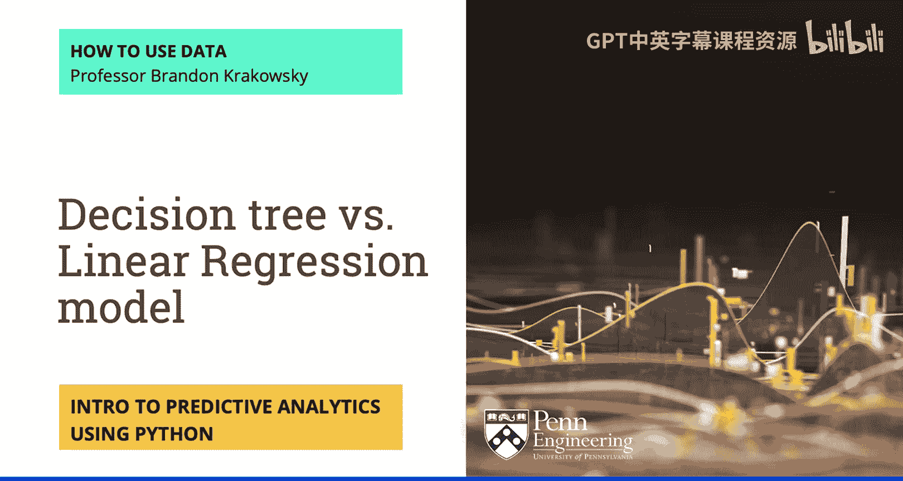
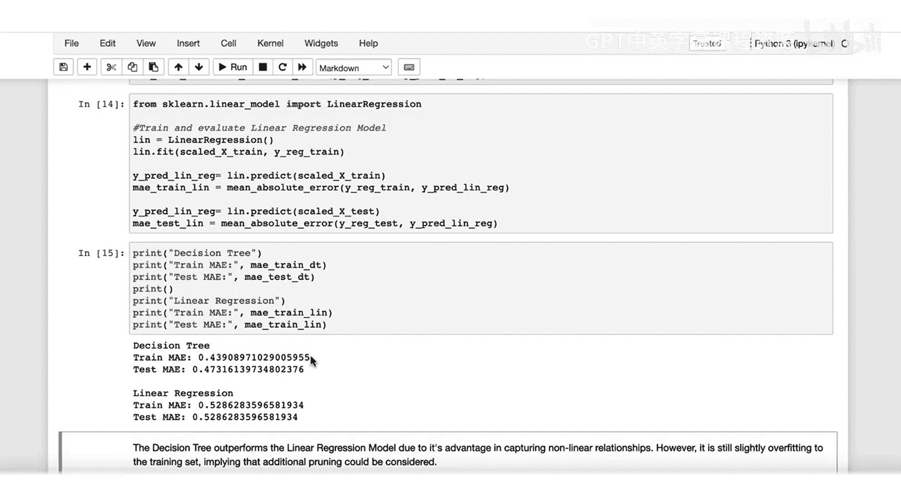

# uPenn《如何运用数据2、3（Python预测分析、数据可视化和叙事）｜How to Use Data》中英字幕 p26 25_编程演示：决策树与线性回归模型对比.zh_en [BV1LqxEzcEBy_p26]

Using the depth limit， lets train and compare the decision tree with a linear regression model。

 As seen before， will initialize a decision tree regressor。This time。

 we'll have a max depth setting equal to 7， in addition to setting the random state to 0。

Once this is done， we'll fit our regressor to our training sets。

So we'll pass it in the scaled x train and the Y train for the regression problem。

And similar to what we've done before， we'll make predictions on the training set and also the test set。

 and we'll calculate the mean absolute error for both cases using the train model。

So we'll execute this and we'll repeat the same process for linear regression as we've seen before in a previous demo。

 We'll initialize a linear regression model without any changes to the default settings。

We fit the model to our training data set for regression。

 and we do the same thing by predicting on the training set and test set and calculating the mean absolute error for both cases。

Now that we've trained the two models， we can evaluate them and display the evaluation results to compare and see which model does better on our dataset。

 So we have an MA of approximately 0。43 and 0。47 on the training and testing respectively for decision tree and about 0。

52 for linear regression in both the training case and the test case。

 So we'll see that the decision tree outperforms the linear regression model due to its advantage in capturing non nonlinear relationships。

 However， it is still slightly overfitting to the training dataset set。

 implying that additional pruning might be needed in future optimizations。

