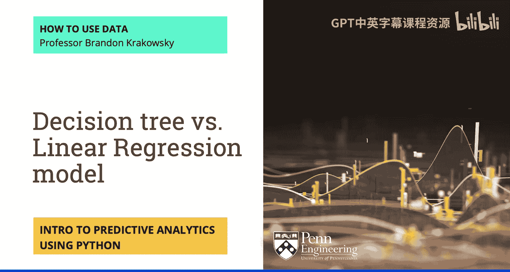
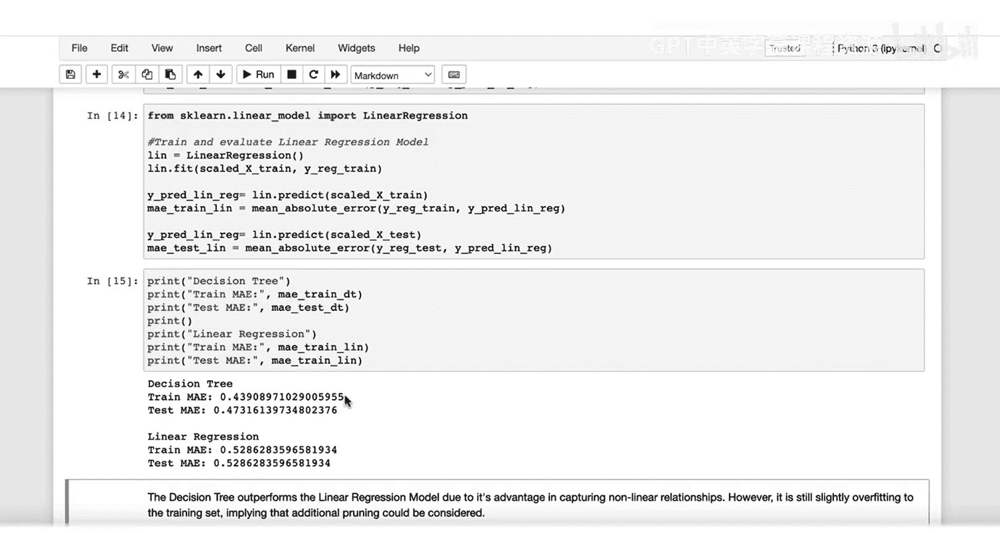

# 预测分析：第26节：决策树与线性回归模型对比编程演示 🆚



在本节课中，我们将通过编程演示，对比决策树回归模型与线性回归模型在相同数据集上的表现。我们将训练两个模型，评估它们的性能，并分析结果。

---

上一节我们介绍了模型评估的指标，本节中我们来看看如何具体实现并比较两种不同的回归模型。

首先，我们使用深度限制来训练一个决策树模型，并将其与线性回归模型进行比较。

我们将初始化一个决策树回归器。这次，除了将随机状态设置为0，我们还将最大深度参数 `max_depth` 设置为7。

```python
# 初始化决策树回归模型，设置最大深度为7，随机种子为0
decision_tree_regressor = DecisionTreeRegressor(max_depth=7, random_state=0)
```

完成初始化后，我们将回归器拟合到我们的训练集上。具体来说，我们将传入缩放后的训练特征 `scaled_x_train` 和回归问题的目标值 `y_train`。

```python
# 使用训练数据拟合决策树模型
decision_tree_regressor.fit(scaled_x_train, y_train)
```

与之前类似，我们将在训练集和测试集上进行预测，并使用训练好的模型计算两种情况下的平均绝对误差。

```python
# 在训练集和测试集上进行预测
y_train_pred_dt = decision_tree_regressor.predict(scaled_x_train)
y_test_pred_dt = decision_tree_regressor.predict(scaled_x_test)

# 计算平均绝对误差
mae_train_dt = mean_absolute_error(y_train, y_train_pred_dt)
mae_test_dt = mean_absolute_error(y_test, y_test_pred_dt)
```

我们执行以上代码，并对线性回归模型重复相同的过程，正如我们在之前的演示中见过的那样。

我们将初始化一个线性回归模型，不更改任何默认设置。

```python
# 初始化线性回归模型
linear_regression_model = LinearRegression()
```

我们将模型拟合到回归问题的训练数据集上。

```python
# 使用训练数据拟合线性回归模型
linear_regression_model.fit(scaled_x_train, y_train)
```

我们做同样的事情：在训练集和测试集上进行预测，并计算两种情况下的平均绝对误差。

```python
# 在训练集和测试集上进行预测
y_train_pred_lr = linear_regression_model.predict(scaled_x_train)
y_test_pred_lr = linear_regression_model.predict(scaled_x_test)

# 计算平均绝对误差
mae_train_lr = mean_absolute_error(y_train, y_train_pred_lr)
mae_test_lr = mean_absolute_error(y_test, y_test_pred_lr)
```

现在我们已经训练了两个模型，我们可以评估它们并展示评估结果，以比较哪个模型在我们的数据集上表现更好。

以下是两个模型的评估结果：
*   对于决策树模型，训练集和测试集的平均绝对误差分别约为 **0.43** 和 **0.47**。
*   对于线性回归模型，训练集和测试集的平均绝对误差均约为 **0.52**。

因此，我们可以看到，由于决策树在捕捉非线性关系方面的优势，其性能优于线性回归模型。然而，它仍然对训练数据集存在轻微的过拟合现象，这意味着在未来的优化中可能需要额外的剪枝操作。

---



本节课中我们一起学习了如何用代码实现决策树与线性回归模型的训练、预测与评估对比。我们看到，在此例中，带有深度限制的决策树模型在测试集上取得了更低的误差，但其在训练集和测试集上的误差差距也提示了过拟合的风险。这为后续的模型优化（如剪枝）指明了方向。