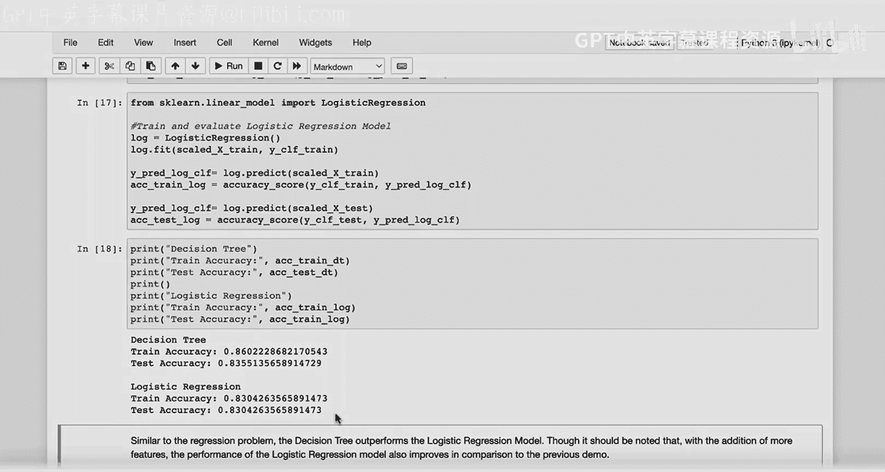

# uPenn《如何运用数据2、3（Python预测分析、数据可视化和叙事）｜How to Use Data》中英字幕 p27 26_编程演示：决策树与逻辑回归模型对比.zh_en [BV1LqxEzcEBy_p27]

Now， let's do a similar comparison for the classification problem。

 We'll use the decision tree classifier and evaluate using the accuracy score。

 which is the percentage of correct predictions over the number of total samples in our data set。

 So here we're importing from S K learn the decision tree classifier。

 We're also importing the metric accuracy score。We'll initialize the decision tree classifier。

So this should be classifier now instead of regressor and similar to the regressor will provide a max depth value equal to 7。

And will set the random state to be 0。Then we'll fit the classifier on our training set。Again。

 we passed in the scaled X train and also the Y train for the classification problem。

Once this is trained and fitted， we can make predictions on the test set and also the training set and calculate the accuracy score for both sets。

So running this， we'll have our trained decision tree classifier and we'll do the same thing for the logistic regression model。

As seen before， we'll initialize our logistic regression model and will fit the model to our training data set using scaled X train and the Y train for classification。

We'll make predictions on the two sets and calculate the accuracy score for each set。

Now that both models are trained and we've also calculated the accuracy scores。

 we can print those out and compare the metrics to see which model performs better。

So for decision trees， we have an accuracy of about 86% on training and 83% on testing。

While the logistic regression model achieves 83% for both cases， similar to the regression problem。

 the decision tree outperforms the logistic regression model， although not by much in this case。

 since the testing accuracy is close and the training accuracy exceeds it by a bit。

Though it should be noted that with additional features。

 the performance of the logistic regression model also improved in comparison to the previous demo。

