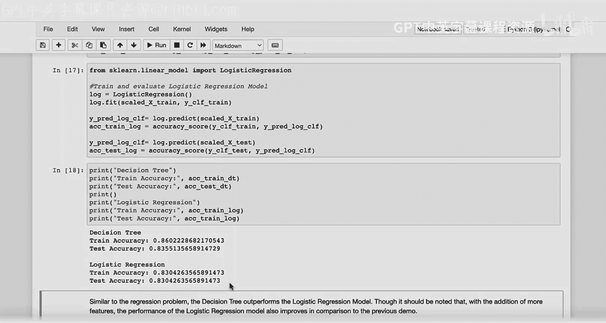

# 机器学习模型对比：P27：编程演示：决策树与逻辑回归模型对比 🆚


在本节课中，我们将学习如何对分类问题使用决策树和逻辑回归模型，并通过准确率来评估和比较它们的性能。

上一节我们介绍了回归问题的模型对比，本节中我们来看看分类问题的模型对比。我们将使用决策树分类器和逻辑回归模型，并在相同的数据集上评估它们的表现。

---

## 模型初始化与训练

首先，我们需要导入必要的库并初始化模型。

```python
# 导入决策树分类器和逻辑回归模型
from sklearn.tree import DecisionTreeClassifier
from sklearn.linear_model import LogisticRegression
from sklearn.metrics import accuracy_score
```

以下是初始化并训练决策树分类器的步骤：

1.  初始化决策树分类器，设置最大深度 `max_depth=7` 和随机种子 `random_state=0`。
2.  使用标准化后的训练特征 `scaled_X_train` 和分类标签 `y_train` 来拟合模型。
3.  对训练集和测试集进行预测。
4.  使用 `accuracy_score` 函数计算两个预测结果的准确率。

```python
# 初始化并训练决策树分类器
dt_classifier = DecisionTreeClassifier(max_depth=7, random_state=0)
dt_classifier.fit(scaled_X_train, y_train)

# 进行预测并计算准确率
y_train_pred_dt = dt_classifier.predict(scaled_X_train)
y_test_pred_dt = dt_classifier.predict(scaled_X_test)

train_accuracy_dt = accuracy_score(y_train, y_train_pred_dt)
test_accuracy_dt = accuracy_score(y_test, y_test_pred_dt)
```

接下来，我们对逻辑回归模型执行相同的流程。

以下是初始化并训练逻辑回归模型的步骤：

1.  初始化逻辑回归模型。
2.  使用相同的标准化训练数据 `scaled_X_train` 和 `y_train` 来拟合模型。
3.  对训练集和测试集进行预测。
4.  计算两个预测结果的准确率。

```python
# 初始化并训练逻辑回归模型
lr_model = LogisticRegression()
lr_model.fit(scaled_X_train, y_train)

# 进行预测并计算准确率
y_train_pred_lr = lr_model.predict(scaled_X_train)
y_test_pred_lr = lr_model.predict(scaled_X_test)

train_accuracy_lr = accuracy_score(y_train, y_train_pred_lr)
test_accuracy_lr = accuracy_score(y_test, y_test_pred_lr)
```

---

## 结果比较与分析

现在两个模型都已训练完毕，并且我们计算了各自的准确率，可以打印出结果进行比较。

```python
print("决策树模型准确率:")
print(f"  训练集: {train_accuracy_dt:.2%}")
print(f"  测试集: {test_accuracy_dt:.2%}")
print()
print("逻辑回归模型准确率:")
print(f"  训练集: {train_accuracy_lr:.2%}")
print(f"  测试集: {test_accuracy_lr:.2%}")
```

运行上述代码后，我们得到如下结果：
*   决策树模型在训练集上的准确率约为 **86%**，在测试集上约为 **83%**。
*   逻辑回归模型在训练集和测试集上的准确率均为 **83%**。

与回归问题类似，决策树模型的性能略优于逻辑回归模型，尽管优势在此案例中并不显著，因为两者的测试准确率非常接近。值得注意的是，**逻辑回归模型在增加了更多特征后，其性能相较于之前的演示也有所提升**。

---



本节课中我们一起学习了如何用代码实现决策树与逻辑回归分类模型，并通过准确率这一核心指标对它们进行了评估和比较。我们了解到，在此特定数据集和参数设置下，决策树模型取得了稍好的表现。