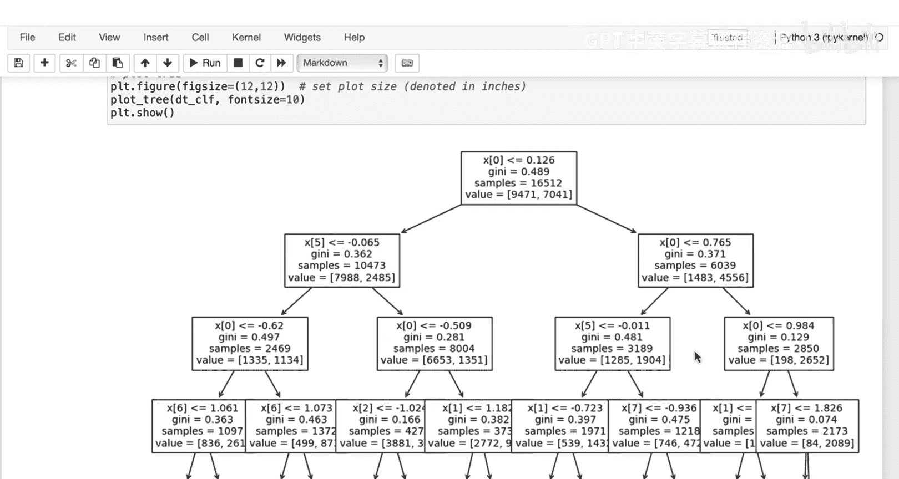

# uPenn《如何运用数据2、3（Python预测分析、数据可视化和叙事）｜How to Use Data》中英字幕 p28 27_编程演示：决策树解读.zh_en [BV1LqxEzcEBy_p28]

Decision trees are useful for interpreting decisions and measuring importance。

 using the decision tree classifier as an example， let's first visualize the structure of the learn tree using plot tree。

 so here we're importing plot tree from SK learnn and also importing matte plotlib we'll plot the figure with a larger figure size and font size so that we can see what's going on in each layer more clearly。

And we'll get to see what the structure of the tree looks like。

So here is the full structure for the tree。 Let's zoom out a bit here to see the whole structure。

Even though we've limited the depth to7， you can see that the tree is still very complex。

And once you get to the lower layers， you have a large number of nodes。

 a large number of leaves covering different cases。

 This is a very big thing to pay attention to when you're training decision trees。

 they can grow very large， really quickly and easily。

So you need to add certain limitations to ensure that your tree is not getting too large and too complex so that it's overfitting to your data。

We'll zoom back in here for each of these squares。 they represent a node that includes a decision rule where your data is being split into two different partitions。

So at each layer， you're making a decision and you're splitting the data for this decision。

 we'd say that for a given sample， if the sixth predictor average occupancy is less than or equal to negative 0。

065， the sample is split into the left node。 Otherwise。

 the right node of the total 10000 or so samples about 8000 are split into the right node and about 2500 into the left。

And the genie index represents purity of the classification， a value between 0 and 1。

