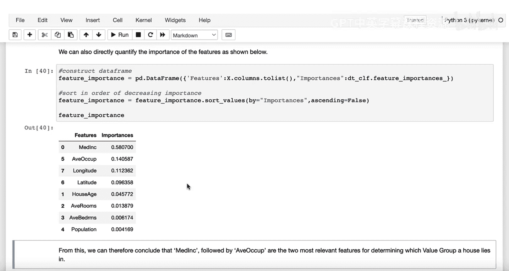

# uPenn《如何运用数据2、3（Python预测分析、数据可视化和叙事）｜How to Use Data》中英字幕 p29 28_编程演示：决策树解读续.zh_en [BV1LqxEzcEBy_p29]

As you go down the tree， you split into smaller partitions。

 and you continue doing so until you reach a leaf node where you can conclude that all of the samples within this node have the same label or have very similar values。

 The higher your square is within your tree indicates the importance of that decision rule。

 in terms of how good the split is， the higher the node is， the better the split。

 The more important that feature involved in the split would be from the structure of the tree。

 we can have a better idea of what decisions are being made during the prediction process through each of these decision rules。

 And these can be， in turn， referenced during actual human decision making。

We can also directly quantify the importance of the features as shown below。

 so here we're going to create a pandas data frame where the features can be retrieved from the columns of our original predictors。

So here we'll create a column called features。From the original predictors in X。

 and then let's extract the columns。 We'll convert those to a list。And then we'll have importances。

Which holds the importance value for each of the features。

This can be obtained by accessing the feature importance attribute from the decision tree classifier。

Once we have this data frame constructed， we'll sort the rows in the data frame in order of decreasing importance。

So here we'll apply the methods， sort values， and then we'll sort by importances。In descending order。

And we can check this pandas data frame。Here we have each of the features and their corresponding importance values。

From this data frame， we can see that median income， followed by average occupancy。

 are the two most relevant features for determining which value group a house sample lies in。

