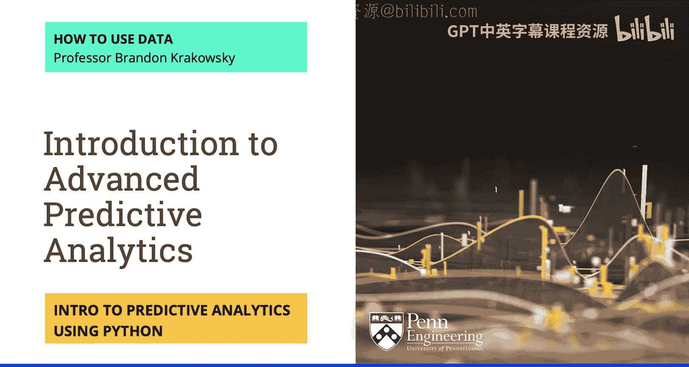
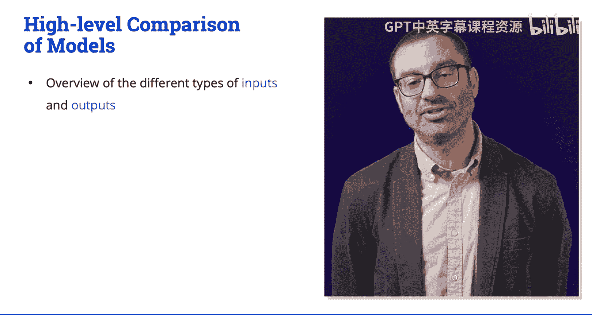
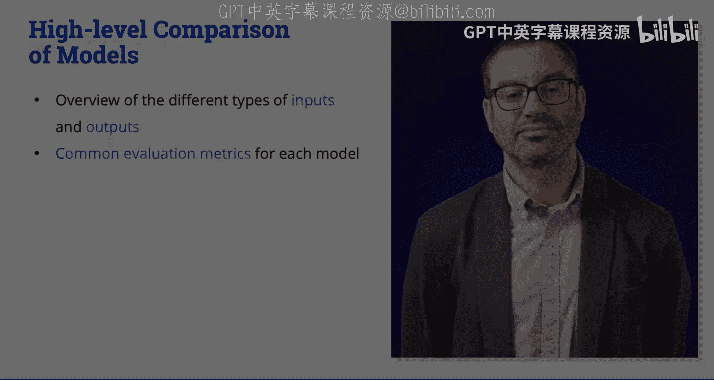

# uPenn《如何运用数据2、3（Python预测分析、数据可视化和叙事）｜How to Use Data》中英字幕 p30 29_高级预测分析导论.zh_en [BV1LqxEzcEBy_p30]

This advanced predictive analytics module is designed to broaden your understanding of supervised and unsupervised learning models。

 We'll begin with exploring more advanced supervised learning models and delving into ensemble methods like random forests。

 We'll examine why we use these methods。 build a random forest model in Python and understand how to interpret its results。

Moving on to unsupervised models will discuss their significance and then dive into clustering。

 We'll focus on K means clustering。 one of the most popular clustering algorithms will guide you in determining the right number of clusters and making sense of your models's outputs。

Finally， we'll wrap up with a high level comparison of different models。

 including an overview of the different types of inputs and outputs and the common evaluation metrics used for each model。

