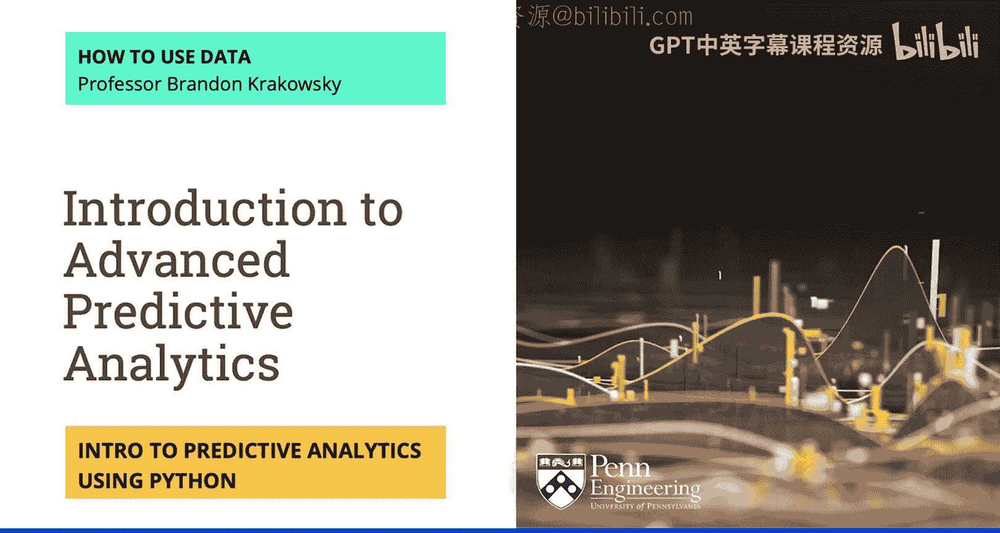
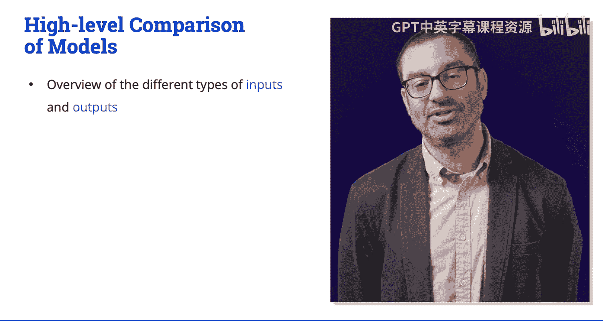
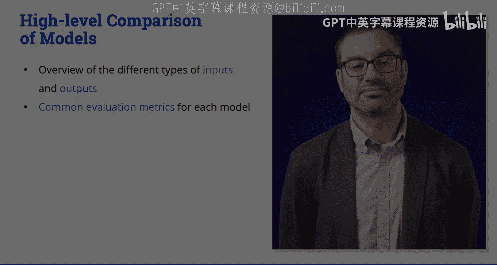

# 高级预测分析：导论

在本节课中，我们将学习高级预测分析的核心概念，包括更复杂的监督学习模型、无监督学习模型，并对不同模型进行高层次比较。

## 监督学习进阶与集成方法

上一节我们介绍了预测分析的基础。本节中，我们将探索更高级的监督学习模型，并深入研究集成方法，例如随机森林。

我们将探讨使用这些方法的原因，在Python中构建一个随机森林模型，并学习如何解读其结果。

以下是构建随机森林模型的关键步骤：

*   **导入库**：`from sklearn.ensemble import RandomForestClassifier`
*   **初始化模型**：`model = RandomForestClassifier(n_estimators=100)`
*   **训练模型**：`model.fit(X_train, y_train)`
*   **进行预测**：`predictions = model.predict(X_test)`

## 无监督学习与聚类分析

了解了监督学习后，我们来看看无监督学习模型。本节将讨论无监督学习的重要性，并深入探讨聚类分析。

我们将重点介绍K均值聚类，这是最流行的聚类算法之一。本节将指导你如何确定合适的聚类数量，并理解模型输出的含义。

以下是K均值聚类的核心公式和步骤：

*   **目标**：最小化簇内平方和（WCSS），其公式为：**WCSS = Σ Σ ||x_i - μ_j||²**，其中`x_i`是簇`j`中的点，`μ_j`是簇`j`的中心。
*   **算法步骤**：
    1.  随机选择K个初始中心点。
    2.  将每个数据点分配到最近的中心点所在的簇。
    3.  重新计算每个簇的中心点（均值）。
    4.  重复步骤2和3，直到中心点不再变化或达到最大迭代次数。

## 模型比较与评估

最后，我们将对不同模型进行一个高层次的比较总结。

这包括对不同模型的输入输出类型进行概述，以及每种模型常用的评估指标。

以下是常见的评估指标：

*   **分类模型**：准确率、精确率、召回率、F1分数、AUC-ROC曲线。
*   **回归模型**：均方误差（MSE）、均方根误差（RMSE）、平均绝对误差（MAE）、R²分数。
*   **聚类模型**：轮廓系数、戴维森堡丁指数。

本节课中，我们一起学习了高级预测分析的主要组成部分：从随机森林等集成方法，到K均值聚类等无监督学习技术，最后对比了不同模型的特性与评估方式。这些知识将帮助你为更复杂的数据分析任务选择合适的工具。