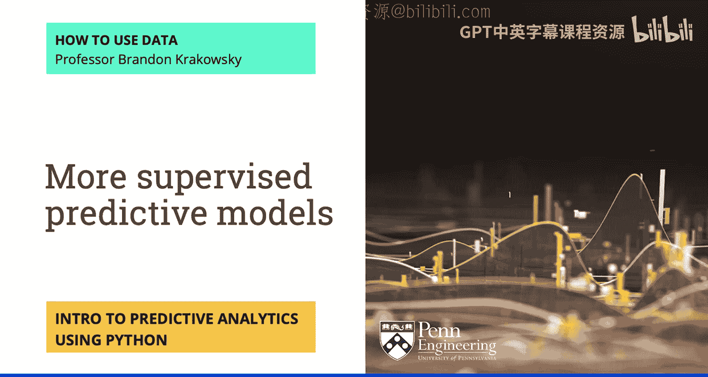
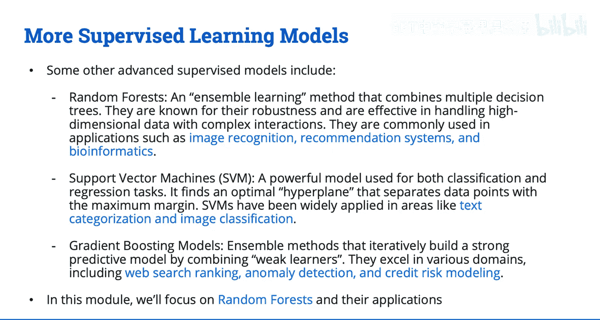

# uPenn《如何运用数据2、3（Python预测分析、数据可视化和叙事）｜How to Use Data》中英字幕 p31 30_更多监督学习模型.zh_en [BV1LqxEzcEBy_p31]

In the previous module， we saw a variety of supervised learning methods， including linear regression。

 logistic regression and decision trees。 Each model has its advantages and limitations in predictive analytics。

 Often for more complex problems and data， we need more advanced models to capture the trends and patterns。

 Some other advanced supervised models include random forests。

 which is an ensemble learning method that combines multiple decision trees。

 Rand forests are known for their robustness and are effective in handling high dimensional data。

 with complex interactions。They're commonly used in applications such as image recognition。

 recommendation systems and bioinformatics。Support vector machines or SVM。

 which is a powerful model used for both classification and regression tasks。

 It finds an optimal hyperplane that separates data points with the maximum margin。

SVMs have been widely applied in areas like text categorization and image classification。

And gradient boosting models， which are ensemble methods that iteratively build a strong。

 predictive model by combining weak learners。 They excel in various domains。

 including web search ranking， anomaly detection and credit risk modeling in this module will focus on random forests and their applications。

