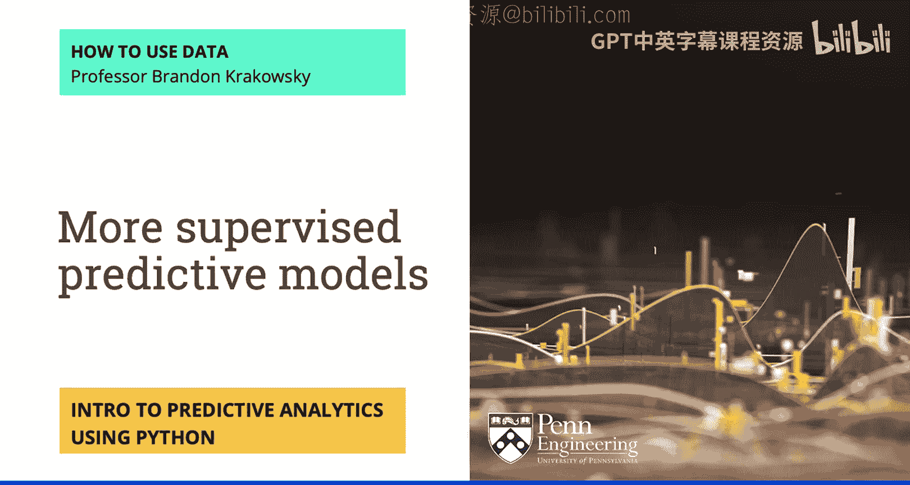
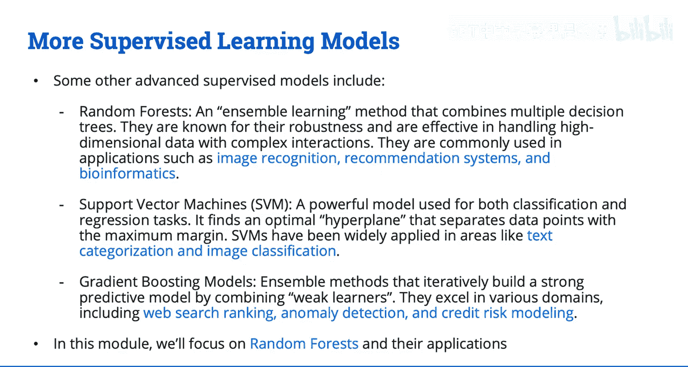

# 数据科学应用：模块31：更多监督学习模型 🌳🤖

在本节课中，我们将学习几种更高级的监督学习模型。这些模型能够处理更复杂的数据和问题，捕捉更深层次的趋势与模式。

在上一模块中，我们介绍了一系列监督学习方法，包括线性回归、逻辑回归和决策树。每种模型在预测分析中都有其优势和局限性。对于更复杂的问题和数据，我们通常需要更高级的模型来捕捉其中的趋势和模式。

## 随机森林 🌲🌲🌲

本节中，我们来看看随机森林模型。随机森林是一种集成学习方法，它结合了多个决策树。随机森林以其鲁棒性著称，能有效处理具有复杂交互关系的高维数据。

以下是随机森林的一些常见应用领域：
*   **图像识别**
*   **推荐系统**
*   **生物信息学**

## 支持向量机 ⚔️

上一节我们介绍了随机森林，本节中我们来看看支持向量机。支持向量机是一种强大的模型，可用于分类和回归任务。它的核心思想是找到一个最优超平面，以最大间隔来分隔数据点。

以下是支持向量机的一些广泛应用领域：
*   **文本分类**
*   **图像分类**

## 梯度提升模型 📈

除了随机森林和支持向量机，梯度提升模型是另一类强大的集成方法。梯度提升模型通过迭代地组合多个弱学习器，来构建一个强大的预测模型。

以下是梯度提升模型表现出色的几个领域：
*   **网页搜索排名**
*   **异常检测**
*   **信用风险建模**

在本模块中，我们将重点探讨随机森林及其应用。

---

本节课中我们一起学习了几种高级监督学习模型：**随机森林**、**支持向量机**和**梯度提升模型**。我们了解了它们的基本概念、核心思想以及各自适用的领域。这些模型为处理复杂的预测分析问题提供了更强大的工具。