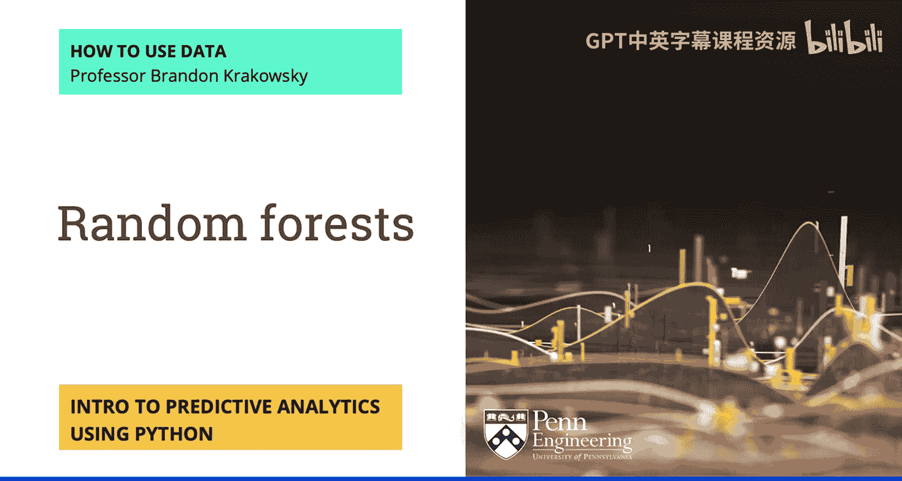
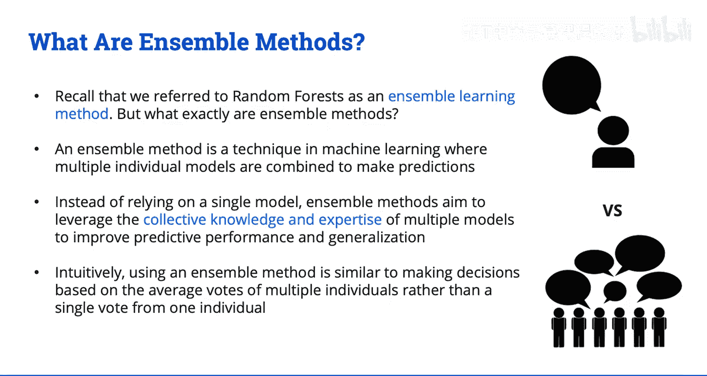
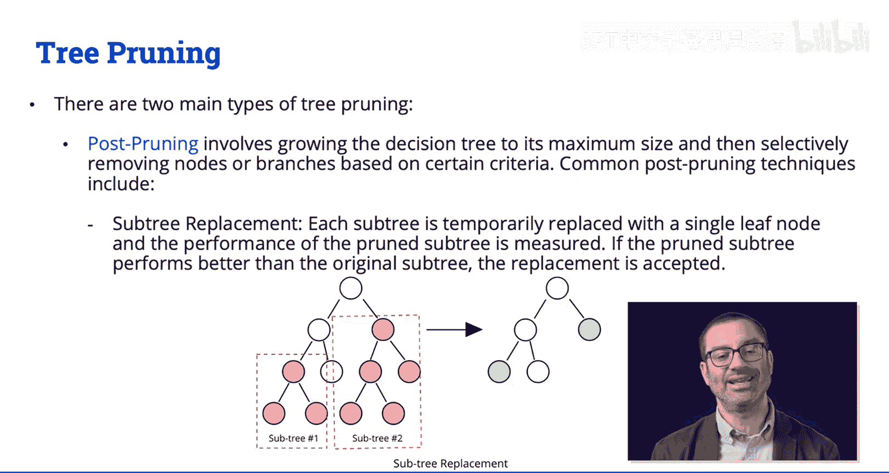

# uPenn《如何运用数据2、3（Python预测分析、数据可视化和叙事）｜How to Use Data》中英字幕 p32 31_随机森林.zh_en [BV1LqxEzcEBy_p32]

Recall that we refer to random forests as an ensemble learning method。

 But what exactly are ensemble methods。 An ensemble method is a technique in machine learning where multiple individual models are combined to make predictions。

Instead of relying on a single model， ensemble methods aim to leverage the collective knowledge and expertise of multiple models to improve predictive performance and generalization。

 Intuitively， using an ensemble method is similar to making decisions based on the average votes of multiple individuals rather than a single vote from one individual。

 Ensemble methods have many advantages。 Imp accuracy。

 by combining multiple models that may have complementary strengths and weaknesses。

 Ensemble methods can capture a broader range of patterns and make more accurate predictions。

Reduced overfitting and increased robustness by combining different models。

 ensemble methods can reduce the risk of overfitting by averaging out individual model biases and errors and thus are more robust to noise and outliers。

 handling complexity， by combining models with different perspectives or using different algorithms。

 Ensemble methods can capture complex patterns and non nonlinearities that may be missed by a single model。

 Overall， ensemble methods are used to improve the performance。

 robustness and generalization of machine learning models by leveraging the combined knowledge and diversity of multiple individual models。

A random forest is a type of ensemble learning method that combines multiple decision trees to make predictions。

 It's a popular and powerful machine learning algorithm used for both classification and regression tasks。

The name random forest comes from the fact that it creates a forest of decision trees。

 where each tree is built using a random subset of the training data and a random subset of the input features。

Let's have a closer look at what happens inside a random forest model during training。

A random forest randomly samples with replacement， a different subset of the original data to train each decision tree in the forest through a process called Botap sampling。

 Intuitively， this allows the trees to learn more diverse perspectives of the data。

Each tree in the forest is grown by recursively partitioning their subset of the data based on criteria like information gain until a stopping criterion is met。

 such as reaching a maximum depth。To make predictions。

 each tree in the forest independently outputs a prediction based on the input features。

For classification tasks， the predictions of the individual trees are aggregated through majority voting。

 and for regression tasks， the predictions are averaged。

The aggregated result becomes the output of the forest。Similar to decision trees。

 random forests can be applied to both regression and classification scenarios。 Hence。

 the evaluation metrics used for decision trees can also be applied to random forests。

 for regression problems， we can use the mean squared error function and for classification problems。

 We can use the accuracy score function。There are advantages to random forests。

 One is reduced overfitting。 Decsion trees are more prone to overfitting。

 while random forests reduce overfitting through combining multiple models。

Another is improved performance。 Random forests offer improved performance and robustness compared to individual decision trees。

There are also disadvantages to random forests。 One is less interpretability。

 Random forests provide less interpretability compared to decision trees due to their ensemble nature of combining multiple models and longer training time。

 training multiple trees can lead to increased training time， especially for large data sets。😡。

As we've seen before， trees can grow very large when trained on complex data sets。

 which could lead to overfitting。 tree pruning is a technique used in tree based algorithms to reduce the complexity and overfitting of the model。

 It involves removing specific branches or nodes from the tree to improve its generalization and performance on unseen data。

There are two main types of tree pruning， pre pruning involves stopping the growth of the decision tree before it becomes fully expanded using certain conditions or heuristics。

Common pre pruning techniques include maximum depth。

 which limits the maximum depth or levels of the tree。And minimum number of samples。

 which specifies a minimum number of samples required in a node for it to be eligible for further splitting。

Post pruning involves growing the decision tree to its maximum size and then selectively removing nodes or branches based on certain criteria。

Common post pruning techniques include minimum error pruning， where starting from the leaves。

 each node is temporarily removed。 And if the error of the model decreases， the removal is accepted。

And subt tree replacement， where each sub tree is temporarily replaced with a single leaf node and the performance of the pruned sub tree is measured。

 If the pruned sub tree performs better than the original sub tree， the replacement is accepted。

