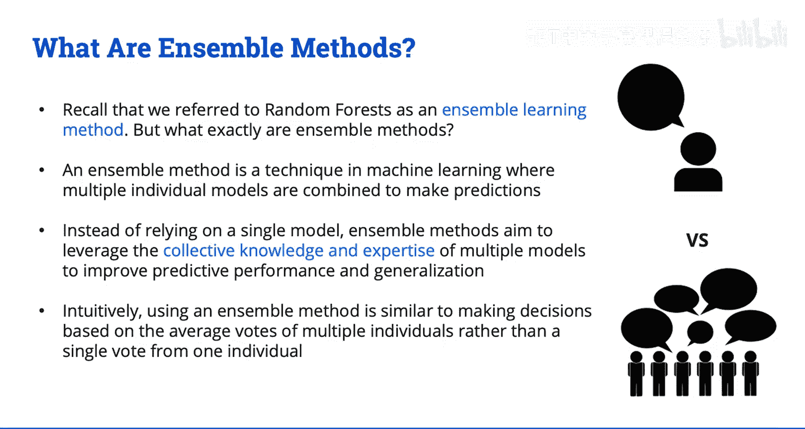
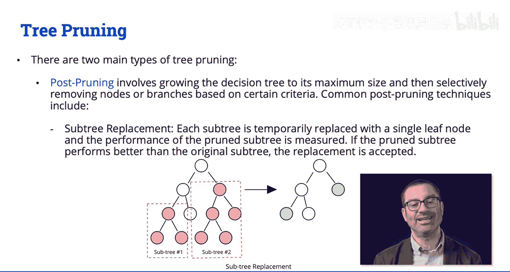

# 机器学习基础：第31章：随机森林 🌲

在本节课中，我们将要学习一种强大的机器学习算法——随机森林。我们将了解什么是集成方法，随机森林如何工作，以及它的优缺点。最后，我们还会探讨决策树剪枝技术，这是防止模型过拟合的重要方法。

## 集成方法简介

上一节我们介绍了决策树，本节中我们来看看如何将多个决策树组合起来，形成更强大的模型。

集成方法是一种机器学习技术，它将多个独立的模型组合起来进行预测。集成方法不依赖单一模型，而是旨在利用多个模型的集体知识和专长，以提高预测性能和泛化能力。直观地说，使用集成方法类似于基于多个个体的平均投票来做决策，而不是依赖于单个个体的投票。

集成方法有许多优点。

以下是集成方法的主要优势：
*   **提高准确性**：通过组合具有互补优缺点的多个模型，集成方法可以捕获更广泛的模式，做出更准确的预测。
*   **减少过拟合并增强鲁棒性**：通过组合不同的模型，集成方法可以通过平均掉单个模型的偏差和误差来降低过拟合的风险，因此对噪声和异常值更具鲁棒性。
*   **处理复杂性**：通过组合具有不同视角或使用不同算法的模型，集成方法可以捕获单个模型可能遗漏的复杂模式和非线性关系。

总的来说，集成方法通过利用多个独立模型的组合知识和多样性，用于提高机器学习模型的性能、鲁棒性和泛化能力。

## 随机森林详解

了解了集成方法的概念后，本节我们来深入探讨随机森林的具体工作原理。

随机森林是一种集成学习方法，它结合多个决策树进行预测。它是一种流行且强大的机器学习算法，可用于分类和回归任务。随机森林这个名字源于它创建了一个决策树的“森林”，其中每棵树都是使用训练数据的随机子集和输入特征的随机子集构建的。

让我们仔细看看随机森林模型在训练期间内部发生了什么。

*   随机森林通过一个称为**自助采样**的过程，随机且有放回地对原始数据进行采样，为森林中的每棵决策树训练一个不同的数据子集。直观地说，这允许树学习数据更多样化的视角。
*   森林中的每棵树都是通过基于信息增益等标准递归地划分其数据子集来生长的，直到满足停止标准（例如达到最大深度）。
*   为了进行预测，森林中的每棵树根据输入特征独立输出一个预测。对于分类任务，单个树的预测通过**多数投票**进行聚合；对于回归任务，预测则被**平均**。聚合的结果成为森林的输出。

与决策树类似，随机森林可以应用于回归和分类场景。因此，用于决策树的评估指标也可以应用于随机森林。对于回归问题，我们可以使用**均方误差函数**；对于分类问题，我们可以使用**准确率得分函数**。

## 随机森林的优缺点

我们已经了解了随机森林如何运作，现在我们来总结一下它的长处和短处。

随机森林有其优点。

以下是随机森林的主要优点：
*   **减少过拟合**：决策树更容易过拟合，而随机森林通过组合多个模型来减少过拟合。
*   **提高性能**：与单个决策树相比，随机森林提供了更好的性能和鲁棒性。

随机森林也有其缺点。

以下是随机森林的主要缺点：
*   **可解释性较低**：由于结合了多个模型的集成特性，随机森林与决策树相比可解释性较低。
*   **训练时间更长**：训练多棵树可能导致训练时间增加，特别是对于大型数据集。

## 决策树剪枝技术

正如我们之前所见，在复杂数据集上训练时，树可能会变得非常庞大，这可能导致过拟合。树剪枝是基于树的算法中使用的一种技术，用于降低模型的复杂性和过拟合。它涉及从树中移除特定的分支或节点，以提高其在未见数据上的泛化能力和性能。

主要有两种类型的树剪枝。

以下是两种主要的剪枝方法：
*   **预剪枝**：在决策树完全展开之前，使用某些条件或启发式方法停止其生长。常见的预剪枝技术包括：
    *   **最大深度**：限制树的最大深度或层数。
    *   **最小样本数**：指定节点中需要满足进一步分裂所需的最小样本数。
*   **后剪枝**：让决策树生长到最大尺寸，然后根据某些标准选择性地移除节点或分支。常见的后剪枝技术包括：
    *   **最小误差剪枝**：从叶子节点开始，临时移除每个节点。如果模型的误差减少，则接受移除。
    *   **子树替换**：每个子树被临时替换为一个叶子节点，并测量剪枝后子树的性能。如果剪枝后的子树比原子树表现更好，则接受替换。

---

本节课中我们一起学习了随机森林。我们了解到随机森林是一种集成学习方法，它通过构建多棵决策树并综合它们的预测结果，来获得比单棵决策树更稳定、更准确的模型。我们还探讨了其优缺点，并学习了通过预剪枝和后剪枝来优化决策树、防止过拟合的技术。