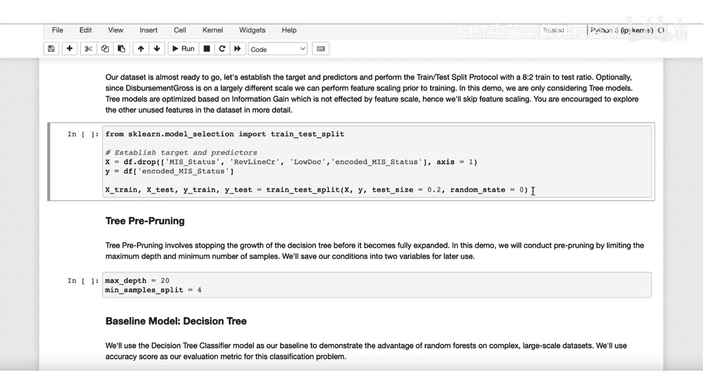

# uPenn《如何运用数据2、3（Python预测分析、数据可视化和叙事）｜How to Use Data》中英字幕 p33 32_编程演示：随机森林数据加载与预处理.zh_en [BV1LqxEzcEBy_p33]

。In this codinging example， we'll tackle the business problem of loan classification with a random forest model。

 The data set that we'll be using comes from the United States Small Business Administration， SBA。

 an organization that strives to create more job opportunities and reduce unemployment by guaranteeing loans for small enterprises in the United States。

In this large scale data set will use the characteristics of previous loan records to perform a binary classification problem of loan status approved or denied。

 considering the complexity of the original data set。

 will' select only a portion of the provided features for this demo。

 You're encouraged to look through the full data set and descriptions via this link here。😊。

So let's start off in loading our data set from the CSV file here。

 we're dropping a few columns that will not be using for the features in this demo。

 So while that's loading， we can have a look at the features that will be including。

 So we'll have a total of8 features and one target variable。

 The description of each feature appears in this table。So we have number of business employees。

 whether this is an existing business or new business， the number of jobs created and retained。

 whether the business is urban or rural or undefined line of credit。

 yes or no loan program and a amount dispersed as well as our target variable。

 which represents the loan status。 So if it's paid in full， that means it's been approved。

 If it's charged off， that means it's been denied。As usual。

 we can use info to get a quick overview of the data that we're using。So here we have about 900。

000 entries。And for the entries， we have both numerical values， as well as non numerical values。

And if we look at the non null count， we'll notice that certain features are missing values in some of the entries。

So since this is a real world data set that has not been pre processed yet。

 we do need to be careful about potential erroneous entries such as missing values or invalid or inconsistent labeling。

So now we'll move on to dealing with some of these issues。

 including the missing values and the non numerical data。

So for the missing values which we can find in the variables， new exist， revolving line of credit。

 also low doc here， and also our target variable will take a straightforward approach and just strictly drop all the entries that have no values。

We can do this by using the Drop NA method on our data。And we'll do this in place。

 meaning that we're modifying the original data frame and not creating a new one。

So we can drop this and also just check the info again， and we'll see that the number of entries。

Has decreased。But now there are no longer any missing values。So once that's done。

 next we can examine the variables that contain non numerical data。So we have here line of credit。

 low doc， disbursement， and our target variable loan status。So we want to look at each one of those。

 as we've seen before， we can perform certain encoding or modifications to transform this into numerical format。

 Let's first take a look at the variables that involve categorical labeling。

 So based on the descriptions that we've seen before， line of credit。

 low doc and our target variable is also a binary label。

 So we'll check to see if the current entries make sense。

So what we can do is have a value count for each of the columns where we're looking for the unique values and corresponding number of samples per each of the labels。

 So execute this。So here we can see that for line of credit。

 we have an addition to the labels that we expect， which is yes or no。

 a bunch of other unexpected labels。We also have a lot of irrelevant labels that were not mentioned in the description for Lo Doc。

Finally， for our target variable， it seems that we don't have any irrelevant labels。

 So the categories match the description。So now that we found the issue with the line of credit and low Doc columns。

 we can make the choice of again， just directly dropping the invalid labels from our data。

 so removing the entries that have invalid labels， and this will occur for both the column line of credit as well as the column low doc。

 so we'll do a Boolean condition to remove the invalid labels from our data。

So here let's create a Boolean condition。 The first condition is that the line of credit column is either equal to y。

 capital Y， or it's equal to capital n。We also want to check the values for the low Doc column。

See if they're equal to y or if they're equal to n。

So these are our two sets of Boolean values and we'll extract the data we need based on those conditions。

So let's run that。And now we can check the value counts again after the modification。

 and we'll see that now we have only the labels that we want。

So the valid ones for all three of the categorical variables。

Considering that we also have two numerical variables that indicate categorical information。

 new exist and urban rural， it makes sense to see if the entries are also consistent with their original descriptions。

 For example， new exist should have the values1 or2， and urban rural should have the values 0，1 or2。

So let's check the value counts。 It seems that urban rural has matching labels with the description。

 but Newexist has both one，2 and also an unexpected label 0。

So let's just again remove entries that have this invalid label from our data set。

So here we'll give another Boolean condition， except now the condition is more simple。

It would just be for new exist， where it's not equal to 0。

So we'll keep one and two and we'll remove those entries where the values are equal to zero。

We'll overwrite our data frame with this subset of the data。

We've already printed this out so we can check it again。

It seems now that we only have labels that we're expecting to see for these two numerical features。

Great， so now we've removed all the inconsistencies from our categorical variables。

 Let's move on to transforming the clean， non numerical data to numerical formats。

As we've seen in the previous demo， we can apply integer encoding to the categorical variables。

 line of credit， low Doc， and our target variable loan status using the factorized method from pandas so we can directly apply this to our data frame。

So when we apply the factorized method， we'll get the encoded values for each of our entries。

 which is the labels in numeric format， and we'll also get a list containing which labels are being used。

 So if we have two labels， for example， yes and no， then there'll be a list containing 0 and one。

 and this will be all of the entries encoded in those labels for line of credit。

We're taking the corresponding column and we're using factorized to get the numeric labels。

 and we can create a new column or we can overwrite。

Let's just create a new column in our data frame and store the encoded entry values in that column。

So this is for line of credit。 We can copy and paste and do the same thing for the other three and do the same thing for low doc。

 at the encoded values and the labels。Apply factorize。Put it in a new column in the data frame。

And then finally， with our target variable。Loone status， get the encoded values， get the labels。

 call factorize。Put the encoded values in a new column in the data frame。

Let's take a look at the first five rows in the data frame just to see if they're being coded properly。

Okay， so it looks like in addition to our original features here。

 we also have the three new labels ready to go in our data set。Great。

 now all that's left is one more nonnumeric variable called disbursement gross。

 which should contain numeric values。 However， they're being stored as values with certain characters such as dollar sign or commas that are preventing it from being a numeric format。

 So if we want to transform this into nu format， we can apply a formatting function to this column that removes the nonnumeric characters and turns the data type into a float。

So we'll need to remove dollar signs and commas and also change it to a float。

So let's do this by overriding our column disbuement gross。And will apply a formatting function。

 which allows us to define a lambda function on the fly。

 which takes as an input each value in the disbursement gross column。

 and will transform the value by first stripping the white space， both leading and trailing。

And then we'll replace the dollar sign。With an empty string。

We're also going to replace a comma with an empty string。And will cast the entire thing to a float。

And we'll apply this to all the values in the disbursement gross column。

And store them back in the original disbursement gross column。So after we apply this。

 let's check the info for the data frame to see it now with all the modifications and feature pre processingces done。

So now we can see that there are no missing values。

Here are the new encoded versions of the categorical variables。We also have the disbursement values。

 Now， it floats。This means our data set is now ready。

We can use all the numerical data for training our random forest model。

 Let's establish the target and predictors and perform the train test split protocol with an 8 to2 train to test ratio。

 Oply， since disbursement gross is on a largely different scale。

 we can perform feature scaling prior to training in this demo， or only considering tree models。

 tree models are optimized based on information gain， which is not affected by feature scale。 Hence。

 we'll skip feature scaling。 You're encouraged to explore the other unused features in the data set in more detail。

So here we've imported train test split and we're dropping out from the original data set。

 these columns。As well as our target variable encoded loan status from our data frame to obtain our predictors。

 We're also taking the encoded loan status as our target variable。

 We're passing these into the train test split function a test size of 20% and a random state set to 0。

Of course， this is going to give us our training data and our test data。

