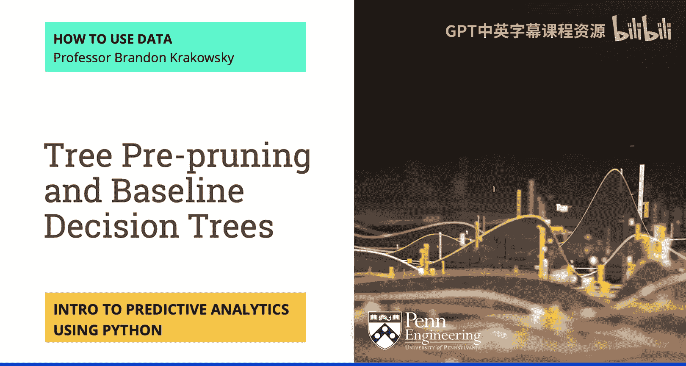
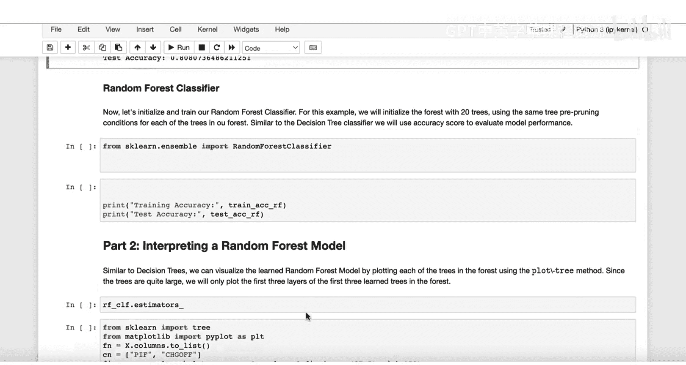

# uPenn《如何运用数据2、3（Python预测分析、数据可视化和叙事）｜How to Use Data》中英字幕 p34 33_编程演示：树预剪枝与基线决策树.zh_en [BV1LqxEzcEBy_p34]

Next， we'll perform tree pre pruning， which involves the stopping of the growth of the decision tree before it becomes fully expanded。

 This prevents the tree model from overfitting to the data。 In this demo。

 we'll conduct pre pruning by limiting the maximum depth and minimum number of samples。

 We'll save our conditions into two variables for later use。 We'll set the max depth to 20。

 which is still quite a large tree， and will set the minten samples split。

 which is the minimum number of samples to continue growing。

We'll use the decision tree classifier model as our baseline to demonstrate the advantage of random forests on complex large scale data sets。

 We'll use accuracy score as our evaluation metric for this classification problem。

 So here we're importing decision tree classifier from S K learned tree were're giving the pre pruning setting So max depth and min samples and also random state and we're fitting this to the training dataset set。

 we're importing accuracy score from the metrics and we're calculating the accuracy score both on the training sets of the test set。

 and we could see what the results would be in this case。

So here we have training accuracy of about 84% test accuracy of about 80%。

 So although this is pretty good， the stats show that there is some degree of overfitting where we're performing really well on the training set。

 but not as well on the test set。 So we're not generalizing as well as we would hope。 Next。

 let's move on to training our random forest classifier。

