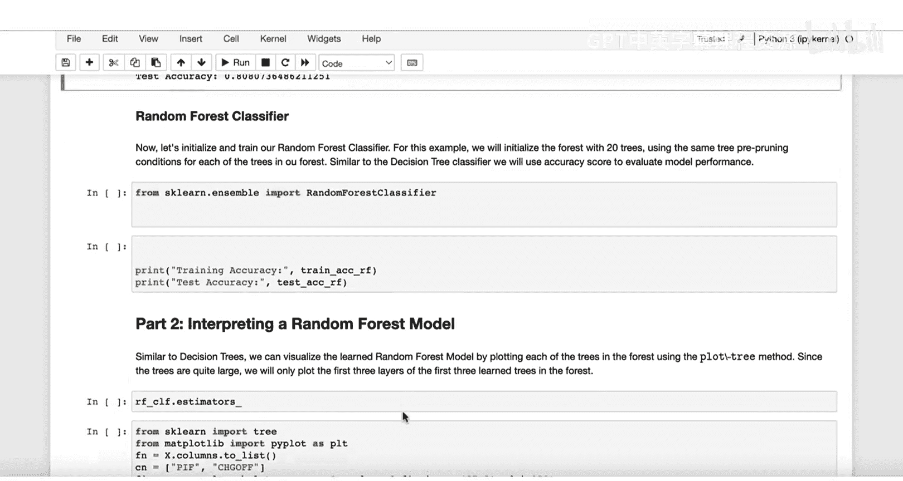

# 机器学习实战：第3章：树预剪枝与基线决策树 🌳


在本节课中，我们将学习决策树模型中的预剪枝技术，并建立一个基线模型。我们将通过限制树的生长来防止过拟合，并评估其性能。

---

上一节我们介绍了决策树的基本概念，本节中我们来看看如何通过预剪枝来控制树的复杂度。

接下来，我们将执行树预剪枝。预剪枝涉及在决策树完全展开之前停止其生长。这可以防止树模型对数据产生过拟合。在本演示中，我们将通过限制最大深度和最小样本数来进行预剪枝。

我们将把预剪枝条件保存到两个变量中以便后续使用。我们将设置最大深度为20，这仍然是一棵相当大的树。同时，我们将设置`min_samples_split`参数，它定义了节点继续分裂所需的最小样本数。

以下是具体的代码实现：

```python
# 导入决策树分类器
from sklearn.tree import DecisionTreeClassifier

# 设置预剪枝参数
max_depth = 20
min_samples_split = 10

# 创建并训练基线决策树模型
baseline_tree = DecisionTreeClassifier(max_depth=max_depth,
                                       min_samples_split=min_samples_split,
                                       random_state=42)
baseline_tree.fit(X_train, y_train)
```

---

在建立了基线决策树模型后，我们需要一个评估标准来衡量其表现。

我们将使用决策树分类器模型作为基线，以展示随机森林在处理复杂大规模数据集时的优势。对于这个分类问题，我们将使用准确率作为评估指标。

以下是计算准确率的步骤：

```python
# 导入准确率评分函数
from sklearn.metrics import accuracy_score

# 计算训练集和测试集上的准确率
train_accuracy = accuracy_score(y_train, baseline_tree.predict(X_train))
test_accuracy = accuracy_score(y_test, baseline_tree.predict(X_test))
```

我们在此案例中可以看到结果。训练准确率约为84%，测试准确率约为80%。虽然这个结果相当不错，但数据表明存在一定程度的过拟合：模型在训练集上表现非常好，但在测试集上表现稍逊。这意味着模型的泛化能力未达到我们的期望。

---



本节课中我们一起学习了决策树的预剪枝技术。我们通过设置`max_depth`和`min_samples_split`参数建立了一个基线模型，并观察到其在训练集和测试集上的性能差异，这揭示了过拟合的存在。接下来，让我们继续训练我们的随机森林分类器，看看它是否能提供更好的泛化性能。