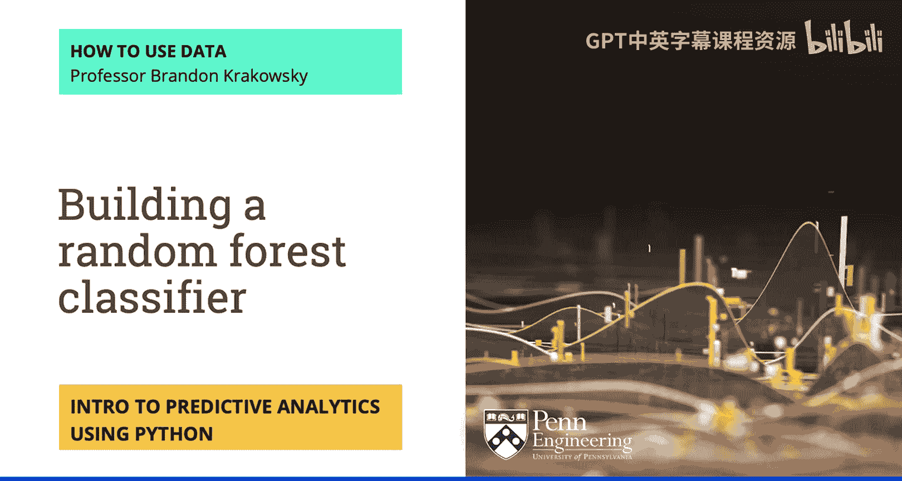
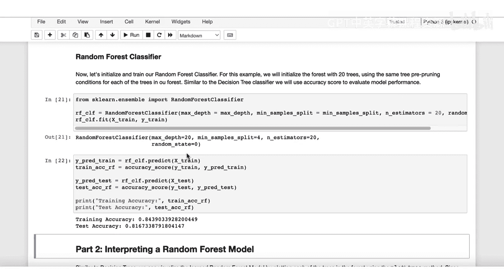

# uPenn《如何运用数据2、3（Python预测分析、数据可视化和叙事）｜How to Use Data》中英字幕 p35 34_编程演示：构建随机森林分类器.zh_en [BV1LqxEzcEBy_p35]

For this example， we'll initialize the forest with 20 decision trees。

 So 20 different trees within your forest using the same tree pruning conditions for each of the trees in your forest。

  similar to the decision tree classifier， will use accuracy score to evaluate model performance。

So here we'll create our random forest classifier using random forest Classifier from Sklen。

 ensemble。We'll pass in the max depth。 This is the number of splits that each decision tree is allowed to make。

And also， the min number of samples， This specifies the minimum number of samples required to split a node。

And will pass in the number of estimators。This is the number of decision trees in the random forest。

 We'll set that to 20。And a random state set to0。So we'll fit the classifier to our training set。

 this might take a while since we do have 20 times as many models in this forest as the decision tree model itself。

Now that the model is trained， we can go ahead and evaluate this model on the training set and test set using accuracy score。

So again， we can get the predictions of each of these samples by predicting on training first。

We can calculate the accuracy using accuracy score。

 comparing the true training values to the predicted train Y values。

And we can repeat this for the test set。So instead of train， we have a test。

So here we're predicting on X test。And then we'll calculate the accuracy score by comparing the true test labels to the predicted test labels。

So running this， we have 84% on the training set and approximately 82 or 81% on the test set。

So although there's not a huge difference， perhaps due to the settings that we've chosen。

 the randomand forestest classifier maintains a similar level of training accuracy as the decision tree。

 but has a higher test accuracy， meaning that by including multiple trees within the forest and averaging out their results。

 we can get a better generalization ability。

