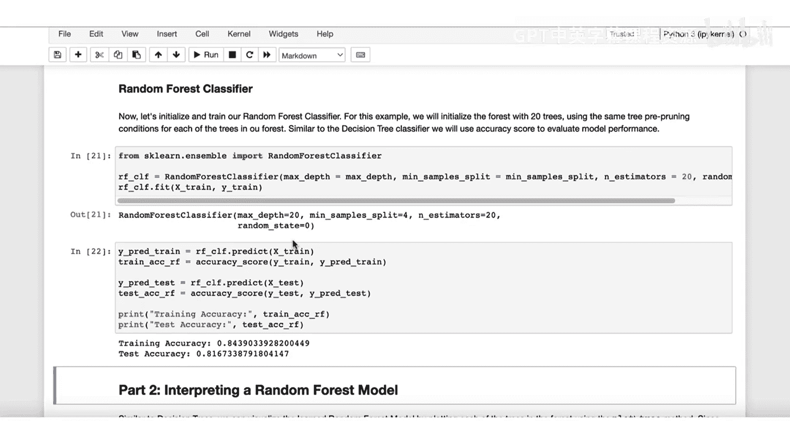

# 机器学习实战：第3章：构建随机森林分类器 🌲


在本节课中，我们将学习如何使用Python的Scikit-learn库构建一个随机森林分类器。我们将从初始化模型开始，逐步完成训练和评估过程，并理解其相对于单棵决策树的优势。

上一节我们介绍了决策树的基本原理，本节中我们来看看如何集成多棵决策树来构建一个更强大的模型——随机森林。

## 模型初始化与参数设置

首先，我们需要从Scikit-learn的集成学习模块中导入随机森林分类器。

以下是初始化随机森林分类器的关键步骤和参数：

*   **导入类**：使用 `RandomForestClassifier`。
*   **设置最大深度 (`max_depth`)**：此参数控制森林中每棵决策树允许的最大分裂次数，用于防止过拟合。
*   **设置最小样本分裂数 (`min_samples_split`)**：此参数指定分裂一个内部节点所需的最小样本数。
*   **设置评估器数量 (`n_estimators`)**：此参数决定随机森林中决策树的数量，本例中我们设置为20。
*   **设置随机状态 (`random_state`)**：为了确保结果可重现，我们将其设置为0。

初始化模型的示例代码如下：
```python
from sklearn.ensemble import RandomForestClassifier

rf_clf = RandomForestClassifier(
    max_depth=5,
    min_samples_split=10,
    n_estimators=20,
    random_state=0
)
```

## 模型训练与评估

初始化分类器后，我们使用训练数据对其进行拟合。由于需要训练20棵决策树，此过程可能比训练单棵决策树耗时更长。

模型训练完成后，我们需要评估其性能。与决策树分类器类似，我们使用准确率分数来评估模型在训练集和测试集上的表现。

以下是评估模型性能的步骤：

1.  **训练集预测**：使用训练好的模型对训练集 `X_train` 进行预测，得到预测标签 `train_pred`。
2.  **训练集准确率计算**：通过 `accuracy_score` 函数，比较真实的训练标签 `y_train` 和预测标签 `train_pred`，计算训练准确率。
3.  **测试集预测与评估**：重复上述过程，对测试集 `X_test` 进行预测，并计算测试准确率。

核心评估代码如下：
```python
from sklearn.metrics import accuracy_score

# 训练集评估
train_pred = rf_clf.predict(X_train)
train_accuracy = accuracy_score(y_train, train_pred)

# 测试集评估
test_pred = rf_clf.predict(X_test)
test_accuracy = accuracy_score(y_test, test_pred)
```
运行评估后，我们可能得到约84%的训练集准确率和约81%-82%的测试集准确率。

## 结果分析与总结

虽然在本例的特定参数设置下，性能提升并不巨大，但结果揭示了一个重要模式：随机森林分类器保持了与单棵决策树相近的训练准确率，同时获得了更高的测试准确率。

这意味着，通过在森林中包含多棵树并汇总它们的结果，模型获得了更好的泛化能力。其核心思想是**集成学习**中的“集体智慧”，通过平均多棵树的预测，可以减少单棵树可能产生的过拟合和方差，从而使模型在未见过的数据上表现更稳定、更可靠。



本节课中我们一起学习了随机森林分类器的构建、训练与评估全过程。我们了解到，通过集成多棵决策树，随机森林能够有效提升模型的泛化性能，是解决分类问题的一个强大且实用的工具。