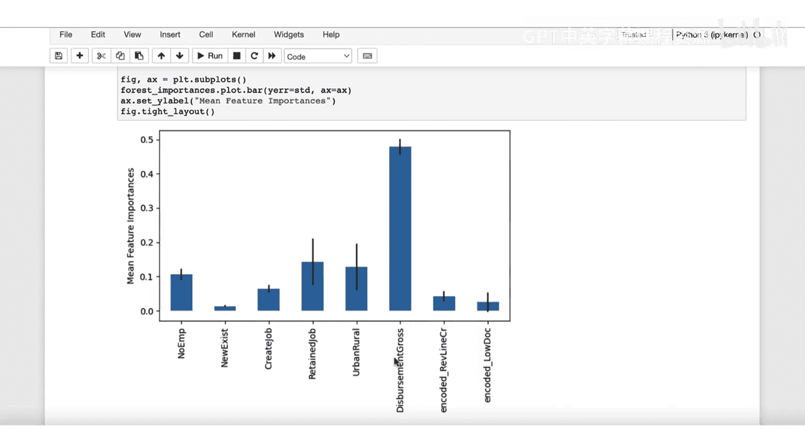

# uPenn《如何运用数据2、3（Python预测分析、数据可视化和叙事）｜How to Use Data》中英字幕 p36 35_编程演示：随机森林解读.zh_en [BV1LqxEzcEBy_p36]

We can visualize the learning in the forest model by plotting each of the trees in the forest using the plot tree method。

 Since the trees are quite large， We'll only plot the first three layers of the first three learned trees in the forest。

 So first， let's take a quick look at the estimators for the random forest classifier。

 This shows us the individual decision tree classifiers used in the random forest。

 So we have 20 decision tree classifiers within the forest。

 Each of them are trained on a different subset of the data。

 And here we're going to take the first three sets。 The first three trees。

 and we'll plot out the tree using the plot tree method。

 We're limiting the depth here because the trees are quite large。

 And we'll see what these three trees look like after they've been trained on our data set。All right。

 So this is the plot of the first three estimators for the first three layers。

 And you'll notice that even though we're technically training on similar data。

 the trees are learning different splits of each layer。

 So estimator 0 is tree splitting on urban rural。 estimator 1 is splitting on retain job。

 and estimator 2 is splitting on disbursement gross。And so the trees are going to grow differently。

 And this is because during training of the forest model。

 we're training each of the trees on a different subset of the original data set。

 meaning that they're gaining different knowledge of the original dataset sets。

 And by averaging out that knowledge， we have a more general idea of what patterns are in the dataset set。

 and we can avoid overfitting the dataset set as we would with just a single tree。

As we've seen previously for decision trees， a tree model allows us to understand feature importance for random forests。

 which consist of multiple trees。 We no longer have an absolute measure of feature importance。

 However， we can still have some understanding of feature importance by looking at the mean and standard deviation of the feature important scores across all trees in the forest。

 Let's calculate and plot out the mean and standard deviation feature important scores for all of the features used as predictors。

 So here， let's first extract the feature names from our predictor columns。

So this will be used to plot out the feature importance headers。

 We can directly extract the mean feature importance values from the forest will access the feature importances attribute。

 Since these are the mean values across all the trees。Using this mean value。

 we can estimate the standard deviation by using the numpy method。Don't forget to import Numpy。

Standard deviation。And we're going to pass a list。Including the mean feature importances。

For each tree。In the forest estimators。Or trees。This will be the standard deviation values for the entire forest。

Finally， we're going to create a series called Forest Iances。

A series is basically a one column data frame。The values will be the importances。

 and the labels will be the feature names。So once we have this set。

 we can plot out a bar plot of the series and provide an error value corresponding to the standard deviation of the feature。

 so let's run that。Oh， it looks like I'm incorrectly referencing the model。

Let me set the forest variable to the classifier。Now we'll rerun that。So here in our plot。

 we can see disbursement gross。This has the highest mean feature importance。

 and the second highest would be retained jobs。But of the two。

 the most important is disbursement gross。 So based on that。

 when you're determining whether a loan is approved or not。

 you might want to first look at the disbursement gross feature and prioritize that over other features。

