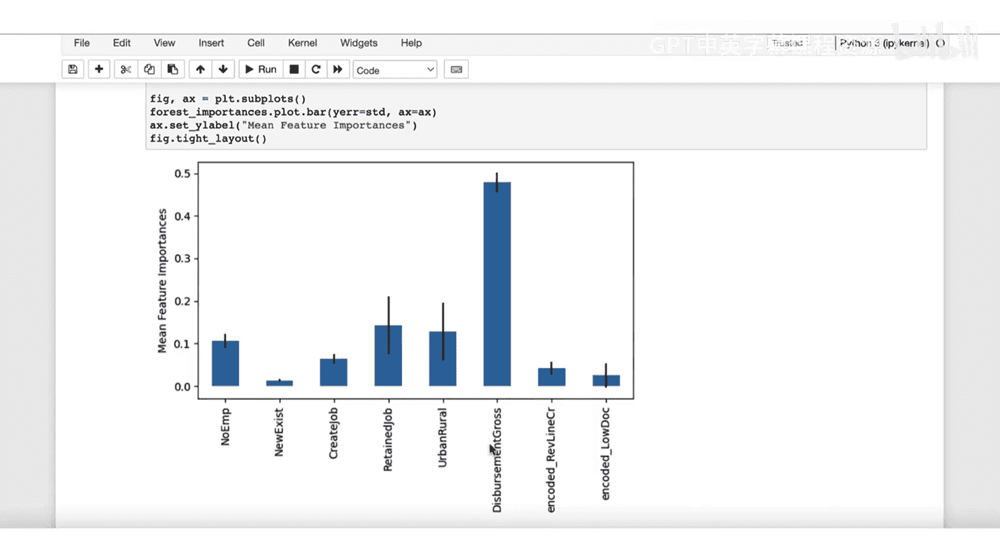

# 机器学习实战：第3章：随机森林模型解读 🧠


在本节课中，我们将学习如何解读随机森林模型。我们将通过可视化森林中的决策树，并计算特征重要性，来理解这个由多棵树组成的“森林”是如何做出预测决策的。

---

## 可视化森林中的决策树 🌲

上一节我们介绍了随机森林的基本概念，本节中我们来看看如何可视化其中的决策树。

我们可以使用 `plot_tree` 方法来绘制森林模型中每一棵树，从而可视化其学习过程。由于这些树通常非常庞大，我们将只绘制森林中前三棵已学习树的前三层。

首先，快速查看一下随机森林分类器的评估器（即单棵树）。

```python
# 查看随机森林中的决策树
print(classifier.estimators_)
```

这段代码会显示随机森林中使用的各个决策树分类器。我们的森林中包含20棵决策树，每棵树都在数据的不同子集上进行训练。

接下来，我们选取前三棵树，并使用 `plot_tree` 方法将其绘制出来。我们将限制树的深度，因为它们非常庞大。

```python
# 绘制前三棵树的前三层
for i in range(3):
    plt.figure(figsize=(20, 10))
    plot_tree(classifier.estimators_[i],
              feature_names=X_train.columns,
              class_names=['Not Approved', 'Approved'],
              filled=True,
              max_depth=3) # 限制深度
    plt.title(f'Estimator {i} (First 3 Layers)')
    plt.show()
```

运行后，我们将看到这三棵树在数据集上训练后的样子。

这是前三棵评估器（树）前三层的图示。你会注意到，尽管我们在技术上使用相似的数据进行训练，但每棵树在每一层都学习了不同的分割规则。

以下是观察结果：
*   评估器0（第一棵树）根据“城乡”特征进行分割。
*   评估器1（第二棵树）根据“保留工作岗位”特征进行分割。
*   评估器2（第三棵树）根据“拨款总额”特征进行分割。

因此，这些树将以不同的方式生长。这是因为在森林模型的训练过程中，每棵树都在原始数据集的不同子集上进行训练，这意味着它们从原始数据集中获得了不同的“知识”。通过对这些知识进行平均，我们能对数据集中存在的模式有一个更概括性的理解，从而可以避免像使用单棵树时可能出现的过拟合问题。

---

## 理解特征重要性 📊

正如我们之前在决策树中看到的，树模型允许我们理解特征的重要性。对于由多棵树组成的随机森林，我们不再拥有绝对的特征重要性度量。然而，我们仍然可以通过查看森林中所有树的特征重要性得分的**平均值**和**标准差**，来对特征重要性有所理解。

让我们计算并绘制出所有用作预测变量的特征的平均值和标准差特征重要性得分。

首先，从预测变量列中提取特征名称。这将用于绘制特征重要性的标题。

```python
# 提取特征名称
feature_names = X_train.columns
```

我们可以直接从森林中提取平均特征重要性值，访问 `feature_importances_` 属性。这些值是所有树上的平均值。

```python
# 提取平均特征重要性
importances = classifier.feature_importances_
```

利用这个平均值，我们可以使用NumPy的方法来估算标准差（别忘了导入NumPy）。

```python
import numpy as np

# 计算标准差
std = np.std([tree.feature_importances_ for tree in classifier.estimators_], axis=0)
```

这将得到整个森林的标准差值。

最后，我们创建一个名为 `Forest_Importances` 的Series（Series本质上是一个单列的数据框）。其值将是重要性分数，标签将是特征名称。

```python
import pandas as pd

# 创建特征重要性Series
Forest_Importances = pd.Series(importances, index=feature_names)
```

一旦设置完成，我们就可以绘制该Series的条形图，并提供一个与特征标准差相对应的误差值。

```python
# 绘制带误差条的特征重要性图
fig, ax = plt.subplots()
Forest_Importances.plot.bar(yerr=std, ax=ax)
ax.set_title("Feature Importances with Standard Deviation (Random Forest)")
ax.set_ylabel("Mean Importance Score")
fig.tight_layout()
plt.show()
```

在我们的图中，可以看到“拨款总额”具有最高的平均特征重要性，第二高的是“保留工作岗位”。但在这两者中，最重要的是“拨款总额”。因此，基于此，当判断贷款是否被批准时，你可能需要首先查看“拨款总额”这一特征，并优先考虑它而不是其他特征。

---



本节课中我们一起学习了如何解读随机森林模型。我们通过可视化森林中的单棵树，理解了其多样化的决策路径；并通过计算特征重要性的均值与标准差，识别出对预测结果影响最大的关键特征（如“拨款总额”）。这有助于我们理解模型的决策依据，并聚焦于最重要的数据维度。