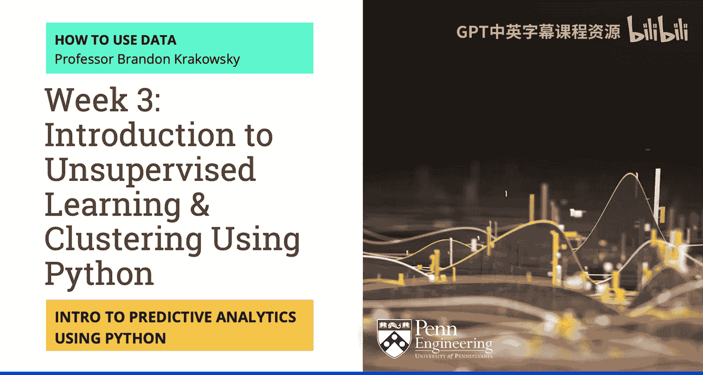
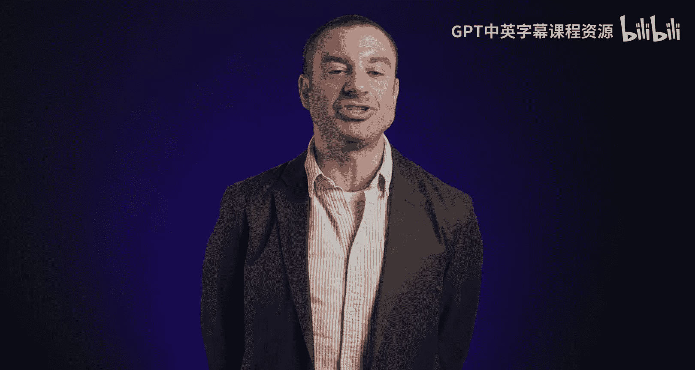
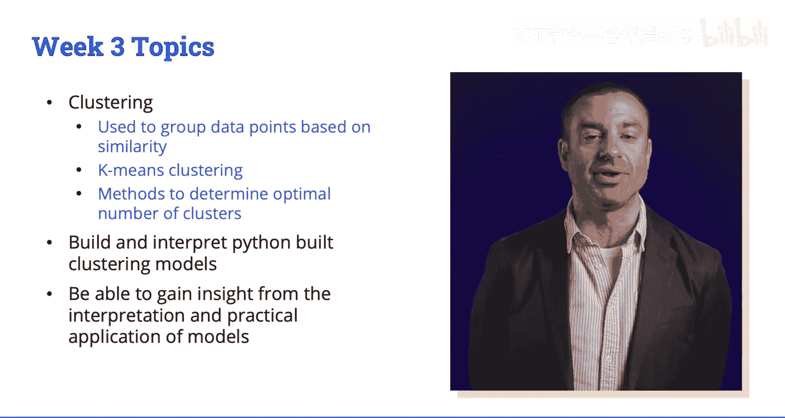
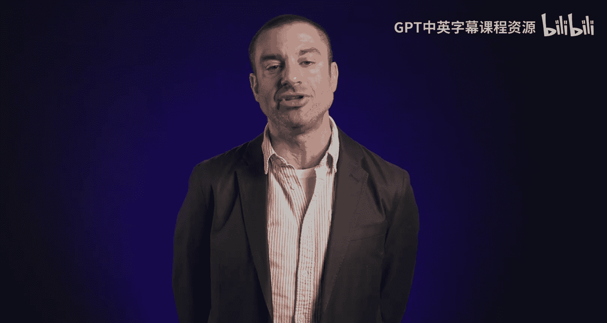

# uPenn《如何运用数据2、3（Python预测分析、数据可视化和叙事）｜How to Use Data》中英字幕 p37 36_第三周导论：无监督学习与聚类.zh_en [BV1LqxEzcEBy_p37]

The final module of the course guides you through the world of unsupervised learning。

 where algorithms learn patterns from unlabeled data。

 We contrast unsupervised learning with supervised learning to highlight its unique challenges and possibilities。

This module focuses on clustering， a principal technique in unsupervised learning used to group data points based on similarity。

We'll cover the concept of clustering， delve into different types。

 such as K means clustering and discuss methods to determine the optimal number of clusters Through practical exercises。

 you'll build and interpret clustering models using Python and gain insights into the practical applications and interpretation of these models。

 This module not only rounds off your understanding of predictive analytics。

 but also equips you with the knowledge to compare and select the most suitable models for various analytical tasks。

 Showcasing the power and versatility of unsupervised learning in data science。😡。

