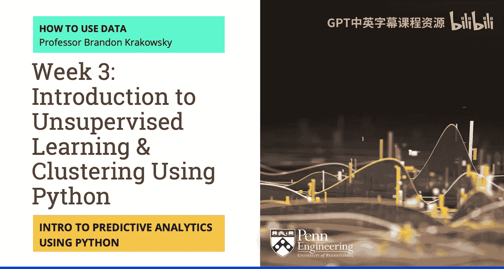
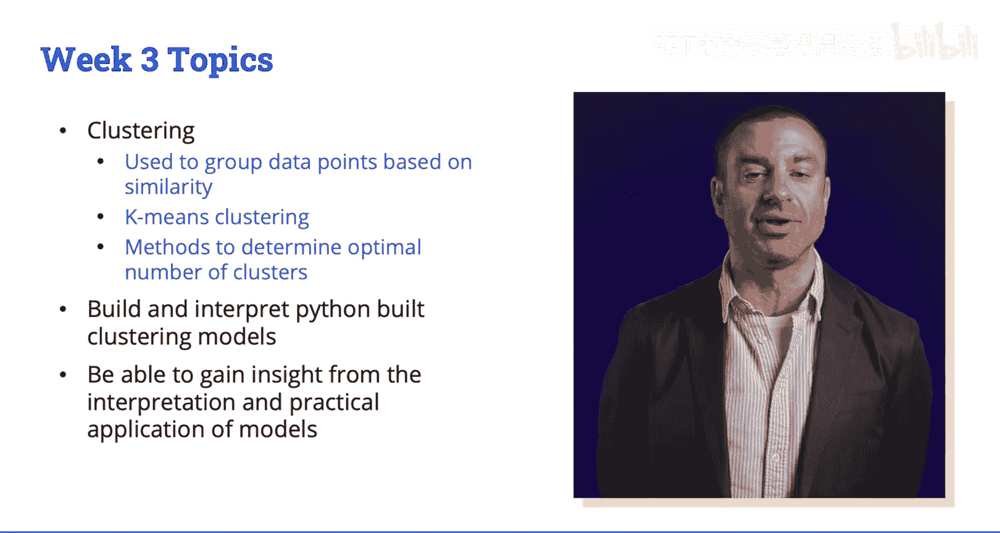

# 预测分析：第三周：无监督学习与聚类导论 🧩

在本节课中，我们将要学习无监督学习的基本概念，特别是其核心方法——聚类。我们将了解它与监督学习的区别，并初步探索聚类的类型和应用。

课程的最后一个模块将引导你进入无监督学习的世界。在这个领域中，算法从**无标签数据**中学习模式。我们将无监督学习与监督学习进行对比，以突出其独特的挑战和可能性。

上一节我们介绍了无监督学习的整体框架，本节中我们来看看本模块的核心内容。

本模块聚焦于**聚类**，这是无监督学习中的一项主要技术，用于根据相似性对数据点进行分组。我们将涵盖聚类的概念，深入探讨不同的类型，例如 **K均值聚类**，并讨论确定最佳聚类数量的方法。通过实践练习，你将使用Python构建和解释聚类模型，并深入了解这些模型的实际应用和解读。本模块不仅完善你对预测分析的理解，还使你具备比较和选择最适合各种分析任务的模型的知识，从而展示无监督学习在数据科学中的强大功能和多样性。

以下是本模块将涵盖的核心主题列表：
*   **无监督学习**：从无标签数据中发现模式。
*   **聚类**：根据相似性对数据点进行分组。
*   **K均值聚类**：一种广泛使用的划分聚类方法。
*   **确定最佳聚类数**：评估聚类模型质量的关键步骤。

本节课中我们一起学习了无监督学习的基本概念及其与监督学习的区别，并重点介绍了聚类技术作为无监督学习的核心。我们了解到，本模块将通过实践帮助我们掌握使用Python进行聚类分析，并学会如何解读和应用聚类模型的结果。