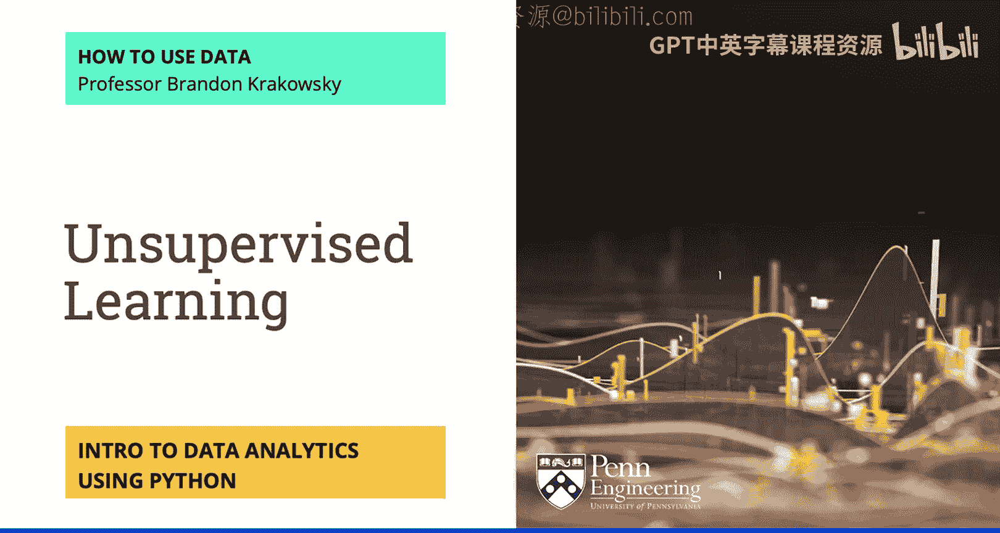
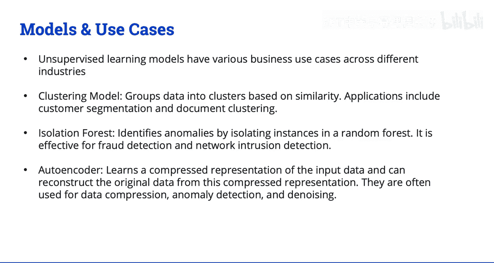

# uPenn《如何运用数据2、3（Python预测分析、数据可视化和叙事）｜How to Use Data》中英字幕 p38 37_无监督学习.zh_en [BV1LqxEzcEBy_p38]

Recall that a supervised learning model tries to make predictions based on a set of labeled examples。

Unsupervised learning attempts to discover patterns， structures or relationships in unlabeled data。

 Unlike supervised learning， there are no explicit correct answers or specific outcomes to be predicted in unsupervised learning。

 Let's imagine you have a dataset set containing information about customers of an e-commerce website that includes various attributes such as age。

 income and browsing behavior。 However， you don't have any predefined labels or categories for these customers。

 using unsupervised learning。 You can group these customers based on their similarities。 For example。

 one group might consist of all high income individuals。

By examining the resulting groups and their characteristics。

 you can gain valuable insights about your customer base。

 This information can be used to tailor marketing strategies。

 Personal recommendations or design specific customer experience for each identified customer group in many real world scenarios。

 obtaintaining labeled data can be challenging， Exp or time consuming。

Unsupervised learning allows us to leverage the abundance of unlabeled data that's often readily available。

Unsupervised learning is valuable for detecting novel or unexpected patterns in the data。

This is particularly useful in anomaly detection， fraud detection。

 or identifying rare events that may be of interest。

Unsupervised learning also complements supervised learning by helping us understand the data and discover hidden patterns which provide a foundation for subsequent data analysis。

 data， pre processing and model development。Unsupervised learning models have various business use cases across different industries。

A clustering model groups data into clusters based on similarity。

Applications include customer segmentation and document clustering。

An isolation forest identifies anomalies by isolating instances in a random forest。

It is effective for fraud detection and network intrusion detection。

 Autoencors are often used for data compression， anomaly detection and dennoising。In this module。

 we'll focus on understanding clustering models。😡。

