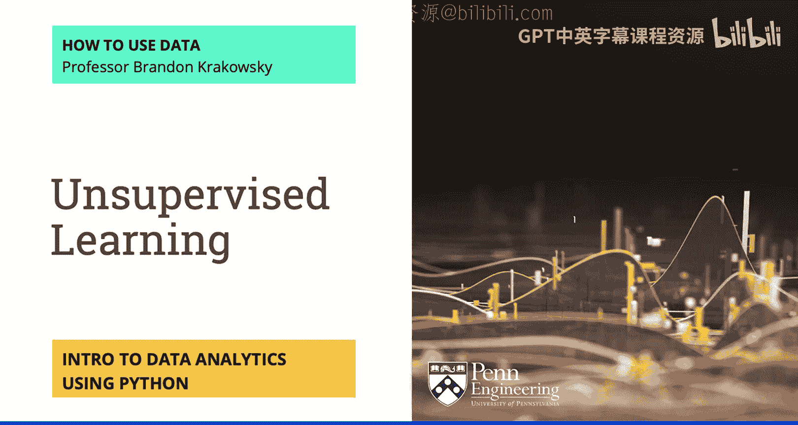
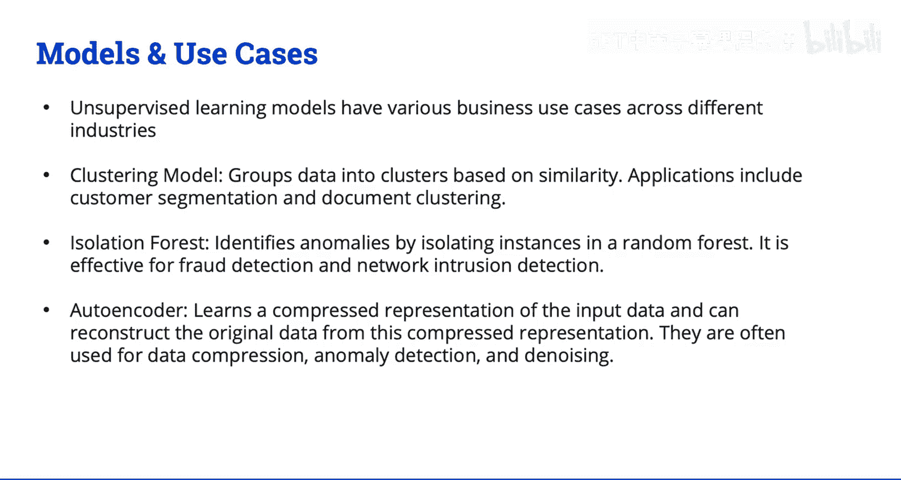

# 无监督学习：第38章：无监督学习概述

在本节课中，我们将要学习无监督学习的基本概念、它与监督学习的区别，以及它在现实世界中的主要应用场景。

## 课程概述

回忆一下，监督学习模型试图根据一组已标记的示例进行预测。

无监督学习则试图在未标记的数据中发现模式、结构或关系。

与监督学习不同，在无监督学习中，没有明确的正确答案或特定的结果需要预测。

## 核心概念与示例

为了更好地理解无监督学习，让我们来看一个具体的例子。

假设你有一个数据集，其中包含一个电子商务网站客户的信息，这些信息包含各种属性，例如年龄、收入和浏览行为。然而，你没有任何为这些客户预定义的标签或类别。

使用无监督学习，你可以根据这些客户的相似性对他们进行分组。例如，一个组可能由所有高收入人群组成。

通过检查产生的分组及其特征，你可以获得关于客户群体的宝贵见解。这些信息可用于定制营销策略、个性化推荐，或为每个已识别的客户群设计特定的客户体验。

## 无监督学习的优势

在许多现实场景中，获取已标记的数据可能具有挑战性、昂贵或耗时。无监督学习使我们能够利用通常容易获得的大量未标记数据。

无监督学习对于检测数据中新颖或意外的模式非常有价值。这在异常检测、欺诈检测或识别可能感兴趣的罕见事件中特别有用。

无监督学习还可以通过帮助我们理解数据和发现隐藏模式来补充监督学习，这为后续的数据分析、数据预处理和模型开发奠定了基础。

## 无监督学习的商业应用

无监督学习模型在不同行业中有各种商业用例。以下是几种常见的模型及其应用：

*   **聚类模型**：根据相似性将数据分组到簇中。应用包括客户细分和文档聚类。
*   **孤立森林**：通过在随机森林中隔离实例来识别异常。它对于欺诈检测和网络入侵检测非常有效。
*   **自编码器**：通常用于数据压缩、异常检测和去噪。

在本模块中，我们将重点理解聚类模型。

## 总结

本节课中，我们一起学习了无监督学习的核心思想。我们了解到，无监督学习旨在从无标签的数据中发现内在结构和模式，这与有明确预测目标的监督学习形成对比。我们探讨了它在客户细分等场景中的应用，并列举了几种常见的无监督学习模型及其商业价值。接下来，我们将深入探讨其中的聚类模型。