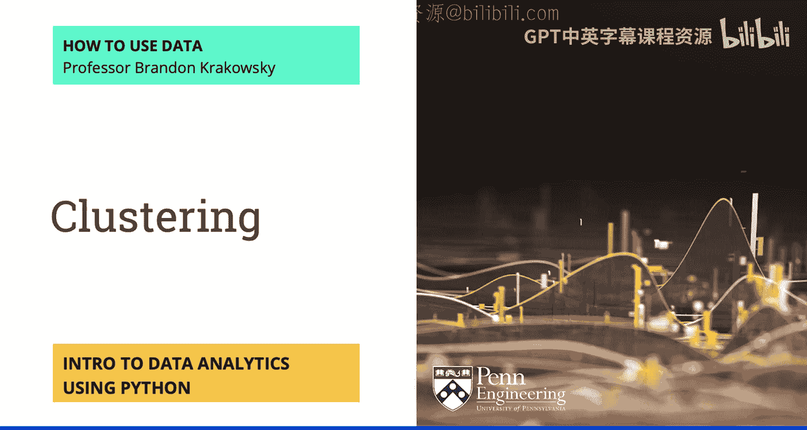
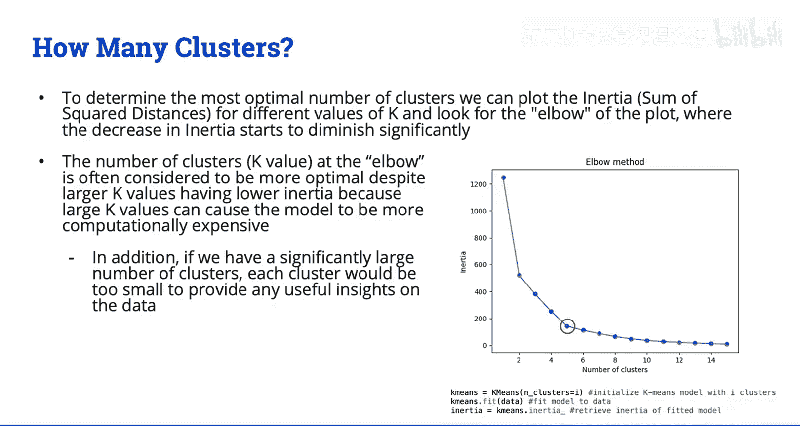

# uPenn《如何运用数据2、3（Python预测分析、数据可视化和叙事）｜How to Use Data》中英字幕 p39 38_聚类分析.zh_en [BV1LqxEzcEBy_p39]

Clustering is an unsupervised learning technique used to group similar instances or data points together based on their inherent characteristics or similarities。

 The goal of clustering is to identify natural groupings or clusters within a data set without prior knowledge of the class labels or target values。

 clustering is widely used in various domains， including customer segmentation， image analysis。

 document categorization， anomaly detection and recommendation systems。

 It's very helpful for data exploration。 pattern discovery。

 Viization and understanding complex data sets。There are several types of clustering algorithms。

 each with its own approach and characteristics。 Some examples include K means clustering。

 which is one of the most popular clustering algorithms。 It partitions data into K clusters。

 where K is a predetermined number。 by minimizing the sum of square distances between the data points and their cluster centroids。

Hiererarchical clustering creates a hierarchy of clusters by iteratively merging or splitting clusters based on similarities until a stopping criterion is met。

Gausian mixture models or GM assume that the data is generated from a mixture of Gaussian distributions。

 GM clustering estimates the parameters of these Gaussian distributions to assign data points to different clusters。

The choice of clustering algorithm depends on the nature of the data， the desired cluster properties。

 and ultimately the specific problem at hand。In this module。

 we'll introduce K means clustering in detail。😡，The goal of K means clustering is to partition data into K clusters。

 where K is a predetermined number based on similarities。

The first step is to randomly select K data points to be the centroids of the K clusters。

The second step is to partition data into K clusters by minimizing the distances between the data points and the cluster centroids。

In other words， for each data point， we identify its closest centroid and group that point into the corresponding cluster。

The third step is for the new K clusters of points calculate a new centroid by taking the mean of all points in the cluster。

 Then repeat steps 1 to 3 until the clusters no longer change or a stop criterion is met。

 Unlike supervised learning scenarios。 We typically don't know the correct answers when performing clustering。

 Hence， we cannot use accuracy or mean squared error to determine what number of clusters allows the model to perform best。

 However， recall that the goal of K means clustering is to minimize the distance between the data points and centroids。

Thus， we can define a metric called sum of square distances， also known as inertia。

 which calculates the sum of squared Euclidean distances between the data points and the centroid of the cluster they belong to。

 In practice， we can use the inertia attribute of a K means in the S K learned dot cluster library。😡。

To determine the most optimal number of clusters， we can plot the inertia or sum of square distances for different values of K and look for the elbow of the plot。

 where the decrease in inertia starts to diminish significantly。The number of clusters。

 the K value at the elbow is often considered to be more optimal。

 despite larger k values having lower inertia， because large K values can cause the model to be more computationally expensive。

In addition， if we have a significantly large number of clusters。

 each cluster would be too small to provide any useful insights on the data。

