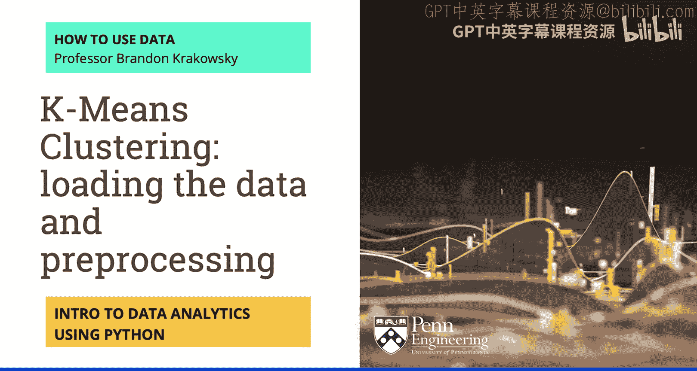
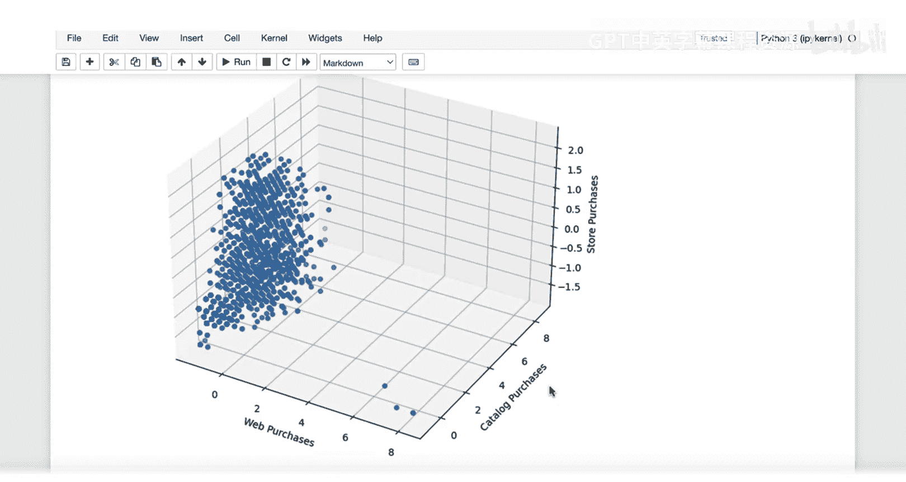

# uPenn《如何运用数据2、3（Python预测分析、数据可视化和叙事）｜How to Use Data》中英字幕 p40 39_编程演示：K均值聚类数据加载与预处理.zh_en [BV1LqxEzcEBy_p40]

嗯。Customer segmentation refers to the process of separating customers into groups that reflect similar characteristics of customers within the group。

In this coding example， we'll be performing an unsupervised K means clustering of data on the customer records from a greries firm's database。

 The dataset set contains 2240 customer data samples。

 Each with 29 attributes covering customer personal information， such as income， education。

 year of birth。  customer purchase information such as amounts spent on different types of products。

 and customer activity information， such as number of web visits per month for visualization purposes in this demo will select only three attributes out of the 29 provided for clustering。

 You're encouraged to look through the full data and descriptions。So first off。

 we'll use Padas to read a CSV file of our data set and store that in a pandas data frame。

And use info to check the features in the data set that we're using。So in the original data set。

 as mentioned， we have 29 attributes。 So this means that we're working with a relatively high dimensional data set。

 and the problem with high dimensional data is that if we want to plot out the data points。

 it's very difficult to visualize in a straightforward way。So for this demo。

 we'll be selecting a subset of 29 attributes instead of using all of them。

 So we'll focus on customer activity and perform clustering based on the number of web purchases。

 number of catalog purchases and number of store purchases。

 So the goal here would be to obtain clusters of customers that indicate certain purchasing behaviors based on these three features。

 So let's index out the three features that we'll be using from the original data frame。

It will create a new data frame Df purchase。And we'll take out the three columns that we need from the original data set。

From Df。First column is going to be number of web purchases。

Second column is going to be number of web purchases。Actually。

 that should be number of catalog purchases。Third column is going to be number of store purchases。

So that would be the three features that we need， and we can check the first few samples of data set using the method head。

So we'll see that for each sample， we have three features indicating the number of purchases for four different platforms。

Now we can have a look at the info again on this subset。I'll use the info method。

So we have three features， and they're all numerical。 They're all integers。

 and it seems that we don't have any missing values。These counts are all non null。

We can also check a description of the data since we are already working with numerical data。

Using describe。And we could see the means in deviation， min， max。It seems that for these features。

 they're not on vastly different scales。And there aren't any really noticeable errors in terms of the statistics here。

 So even if they're not on very largely different scales。

 it still benefits to perform feature scaling。 So we already have numerical data。

And there aren't any missing values， so we can directly go to pre processingcessing the data using a feature scalar。

So here we're using standard scale layer from SK learnn。

This allows the data to have zero mean and unit standard deviation after scaling。So for all features。

 they would have zero mean in unit standard deviation。So once we've initialized our scalar。

 we can fit it to our data。Using the fit method。And given our data frame of purchases。Next。

 since this is only fitting the data but not actually transforming the data。

 we can create a new data frame called scale DF。And we'll create a new data frame。

Which will include the transformed purchase values。And the same column headers。

Now let's describe the scaled data frame。Now we can see the scaled values。So if we look here。

 the mean values are very close to0。The standard deviation values are really close to one。

So now all of our three features have been properly scaled。Now。

 since the data that we're working with has only three dimensions， so three features。

 we can plot out the data as a scatter plot in 3D before we even do clustering。

 just to see if there are any noticeable boundaries that we can segment the data on。

 So here we have the three features as X， Y and Z respectively。

 and we're scattering these on a 3D scatter plot to visualize the data。So if we have a look。

 this is our data set， we'll zoom out a little。So the bulk of the data lies here。

And we do have a few outliers around here。So there's three outliers of this case。

 depending on the problem， you might or might not want to take these three outliers out of your data set prior to performing the clustering or applying any other models。

 We'll just keep it as is， since these outliers don't seem to be very noisy。

 They might be able to fall into one of the clusters。 So we'll just keep it as is。

 So from these results， we don't really have any noticeable clusters to the human eye。

 but we don't have to worry about that because that'll be the job of the K means clustering model。

