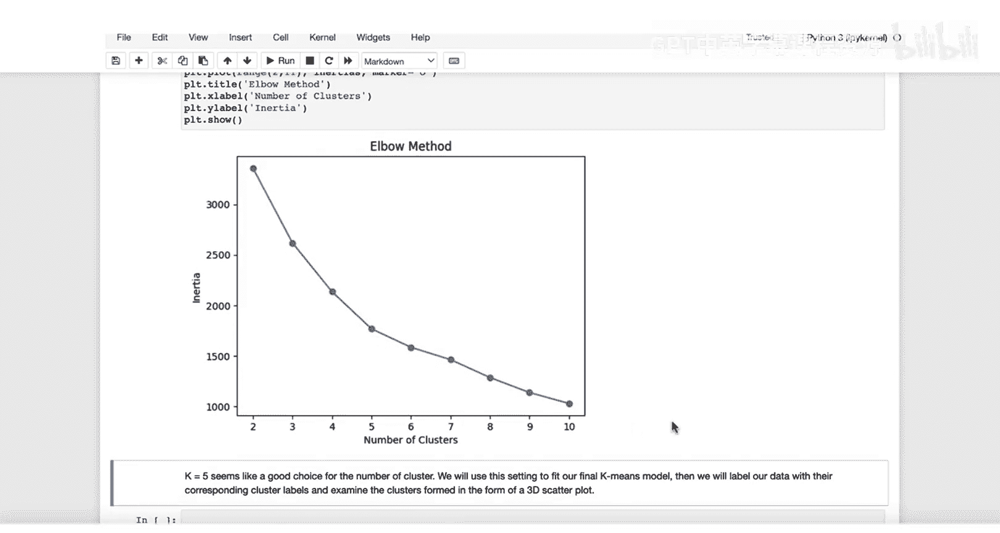

# uPenn《如何运用数据2、3（Python预测分析、数据可视化和叙事）｜How to Use Data》中英字幕 p41 40_编程演示：确定最佳聚类数.zh_en [BV1LqxEzcEBy_p41]

So we'll fit our K means model to the data above for K values between 2 and 10 we'll iterate over a range。

From 2 to 10。We'll create a K means model。 And we'll use the given eye as the number of clusters。

 We're iterating and trying different values for I。

 because we want to find the ideal number of clusters。Then we'll fit the data。

Then we'll look up the inertia of the cameian' clustering model。And add that to our list of inertias。

The inertia measures how well the data set was clustered by the K means。

Now let's plot all the inertias to see which one is the best。We'll use the elbow method。

Let me just fix some of these errors here。This should be in nurses now rerun it。

So this shows for each of the K values， the inertia of the model。

 And we'll look for the elbow point of inertia in our plot。

 And you can see that the plot falls down significantly between 2 and 5 and kind of smooths out after 5。

 So according to the elbow method， we'll find the point where after the decrease in inertia is not as significant as before。

 So in this case， a suitable point would be 5。It looks like an elbow here where afterwards。

 the inertia goes slower。So in this case， we'll use k equals 5 as our cluster number。

 and we'll use the setting to fit our final K means model。

 and we'll label our data with our corresponding cluster labels and examine the clusters formed in a 3D scatter plot。

