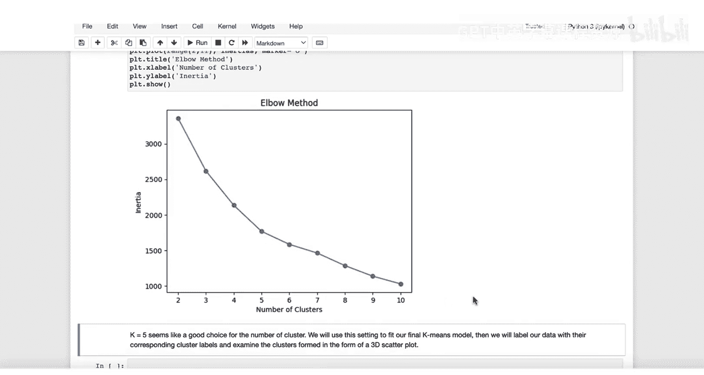

# 数据科学实战：第40章：编程演示：确定最佳聚类数 🎯


在本节课中，我们将学习如何使用Python代码来确定K-Means聚类算法中的最佳聚类数。我们将通过一个完整的编程演示，从拟合模型到可视化结果，一步步找到数据最合适的“K”值。

上一节我们介绍了K-Means聚类的基本原理，本节中我们来看看如何通过编程实践来确定最佳的聚类数量。

---

首先，我们需要为K值在2到10的范围内分别拟合K-Means模型。我们将遍历这个范围，为每个K值创建一个模型并进行拟合。

以下是实现这一步骤的代码：

```python
# 导入必要的库
from sklearn.cluster import KMeans

# 初始化一个列表来存储每个K值对应的模型“惯性”（inertia）
inertias = []

# 遍历K值从2到10
for i in range(2, 11):
    # 创建K-Means模型，指定聚类数为当前的i
    kmeans = KMeans(n_clusters=i)
    # 使用数据拟合模型
    kmeans.fit(data)
    # 获取模型的惯性值并添加到列表中
    inertias.append(kmeans.inertia_)
```

我们遍历并尝试不同的K值，目的是为了找到理想的聚类数量。然后，我们查看每个K-Means聚类模型的“惯性”值，并将其添加到惯性列表中。

**惯性**（Inertia）衡量的是K-Means算法对数据集聚类效果的好坏，其值越小，表示聚类效果越好。

---

现在，让我们绘制所有惯性值，以找出最佳的K值。我们将使用“肘部法则”来进行判断。

以下是绘制惯性值折线图的代码：

```python
import matplotlib.pyplot as plt

# 绘制K值与对应惯性值的折线图
plt.plot(range(2, 11), inertias, marker='o')
plt.xlabel('Number of clusters (K)')
plt.ylabel('Inertia')
plt.title('Elbow Method For Optimal K')
plt.show()
```

让我先修正一些代码错误。现在重新运行它。

该图表显示了每个K值对应的模型惯性。我们将在图中寻找惯性值的“肘点”。

你可以看到，惯性值在K=2到K=5之间显著下降，而在K=5之后下降趋势变得平缓。

因此，根据肘部法则，我们需要找到惯性值下降不再像之前那样显著的点。在这个案例中，一个合适的点就是K=5。图中此处看起来像一个“肘部”，在此之后惯性值下降速度变慢。

---

所以，在这个案例中，我们将使用K=5作为最终的聚类数量。

我们将用这个设置来拟合最终的K-Means模型，为数据打上对应的聚类标签，并在一个3D散点图中检查形成的聚类。

以下是最终建模和可视化的代码：

```python
# 使用最佳K值（5）创建最终模型
final_kmeans = KMeans(n_clusters=5)
final_kmeans.fit(data)

# 为数据点分配聚类标签
cluster_labels = final_kmeans.labels_

# （假设数据是三维的）在3D散点图中可视化聚类结果
fig = plt.figure()
ax = fig.add_subplot(111, projection='3d')
ax.scatter(data[:, 0], data[:, 1], data[:, 2], c=cluster_labels, cmap='viridis')
ax.set_xlabel('Feature 1')
ax.set_ylabel('Feature 2')
ax.set_zlabel('Feature 3')
plt.title('3D Scatter Plot of Clusters (K=5)')
plt.show()
```

---



本节课中我们一起学习了如何通过编程确定K-Means聚类的最佳K值。我们首先遍历了多个K值并计算了每个模型的惯性，然后利用肘部法则通过可视化图表找到了最佳聚类数（K=5），最后用该参数完成了最终的聚类并进行了可视化展示。这个方法帮助你避免随机选择聚类数，使聚类分析的结果更具说服力。