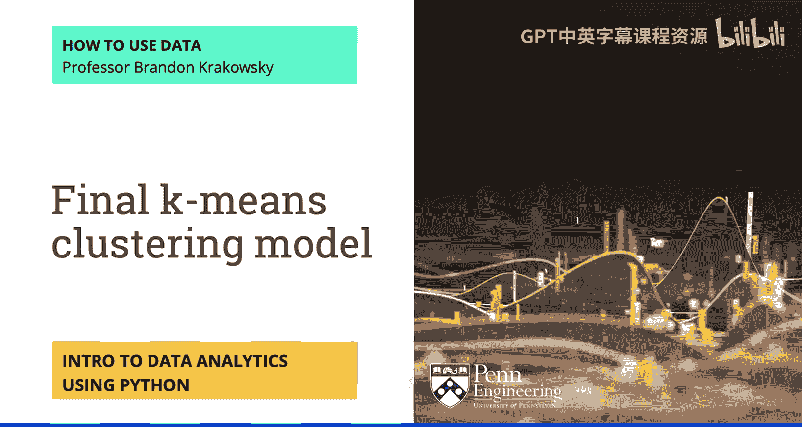
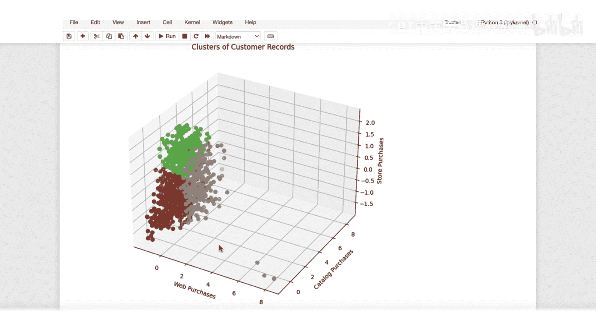

# uPenn《如何运用数据2、3（Python预测分析、数据可视化和叙事）｜How to Use Data》中英字幕 p42 41_编程演示：最终K均值聚类模型.zh_en [BV1LqxEzcEBy_p42]

So let's take these settings and define our final K means model。

Where the number of clusters is equal to 5。We can access the cluster labels by using Fit Predict。

So what this does is it fits our model to our data that we're providing。 So scale Df。

 it will also predict the cluster labels for that data set。So for each data point。

 it'll have a cluster label。Maybe we can store the labels in the new column clusters。

Let's have a look at the first few samples。So notice in addition to the first three features。

 we also have a cluster label for each sample， and we can use this label to visualize the data points with different colors so that our clusters can be seen in the 3D scatter plot。

So here we're still using the same X， Y， Z， So the first three features in addition we're passing in a color value or color label based on the cluster label here。

 and we're giving a color map so that each of the cluster labels are mapped to a certain color when the points are being plotted。

When we execute this， we'll see that our clusters have now been labeled。So we have a gray group。

 green group， brown， red and orange， amounting to a total of five clusters。

 And there does seem to be boundaries between the clusters。 now that we have them labeled clearly。

 the next step would be for us to look a little more in detail into what characteristics each of these clusters has。

