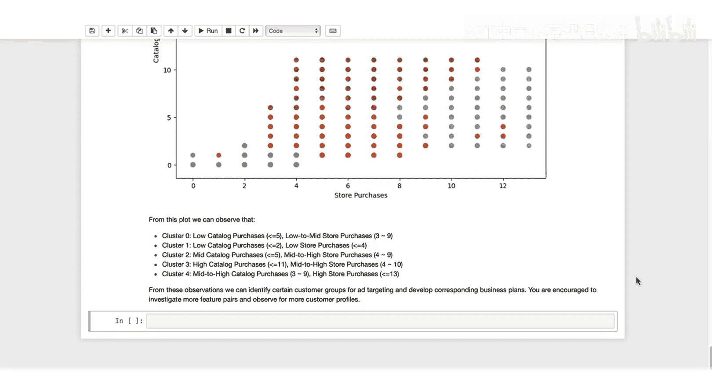

# uPenn《如何运用数据2、3（Python预测分析、数据可视化和叙事）｜How to Use Data》中英字幕 p43 42_编程演示：K均值聚类模型解读.zh_en [BV1LqxEzcEBy_p43]

Recall that clustering is a form of unsupervised learning。

We don't have a correct answer to evaluate our model。

 So the purpose of this section is to figure out how to interpret the patterns formed by the clusters。

Let's first take a look at the distribution of the clusters。

 so here we'll do a value count of data samples for each of the clusters。

And store the cluster labels into X。So on the horizontal axis。

 we'll have a cluster label and we'll store the number of samples for each cluster and y。

Meaning that a vertical axis represents the number of points in each cluster。

We'll create a bar plot using these two x and y。Inside this bar plot。

 we can see that cluster 0 seems to take up a large portion of the data in comparison to the remaining four clusters。

While the remaining four seem to be relatively more freely distributed by observing the distribution of clusters。

 we can get an initial understanding of how the customer base is being weighted into each of the clusters。

 For example， if cluster 0 has characteristics that we would like to emphasize and also has a large number of customers within that group。

 this might mean that we need to prioritize this cluster of customers when we make certain decisions。

 in addition to the distribution。Let's now also take a look at the characteristics within the clusters。

So here in this demo， we've only used three features allowing for visualization of the cluster points directly。

 However， for higher dimensional points， this is not feasible。Instead。

 we can plot out the cluster points using pairs of features that we want to investigate to perform profiling on the customer base。

 Let's have a look at the cluster points using number of store purchases and number of catalog purchases as our feature pair。

 Note that we'll be using the original data rather than the scale data in order to interpret the patterns。

 So first off， here we have a new column created in an original data。

 And we're passing over the cluster labels that we obtained。

 Then we're creating a 2 D scatter plot using the data and the two features。

Number of store purchases and number of catalog purchases。

And we're using the clustering labels as a color map to plot our points when we plot out the data and we'll zoom out a bit so we can see everything more clearly。

We can see that our clusters are distributed with some amount of decision boundaries between the clusters。

 and we have the colored label at the top。Right from this plot。

 we can observe certain characteristics in each of the clusters。 For example， for cluster 0。

 we can see that the samples in the data have low catalog purchases。

 less than or equal to 5 and low to mid store purchases， about 3 to 9。 And then for cluster1。

 we could see low catalog purchases， less than or equal to 2。 and then low store purchases。

 less than or equal to 4。For cluster 2， we can see mid catalog purchases less than or equal to5 and mid to high store purchases。

 about 4 to 9。And then for cluster 3， high catalog purchases。

 less than or equal to 11 and mid to high store purchases， about 4 to 10。 And then finally。

 for cluster 4， we could see mid to high catalog purchases。

 about 3 to 9 and then high store purchases， less than or equal to 13 from these observations。

 we can identify certain customer groups for ad targeting and for developing corresponding business plans。

 So， for example， if a certain group is leaning towards catalog purchases。

 we might want to put our ad efforts into that platform。

 instead of store for those customers in particular。

 You're also encouraged to investigate more feature pairs。😊。

