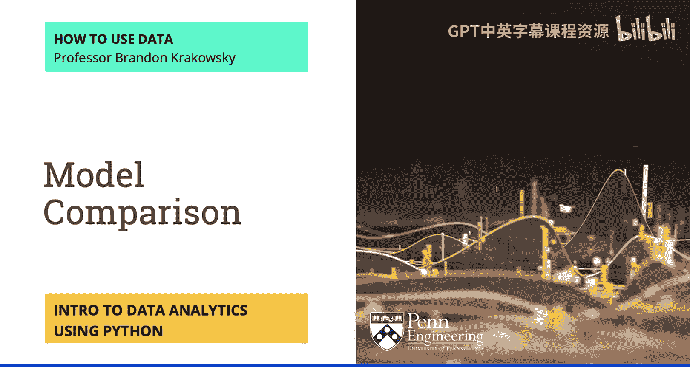
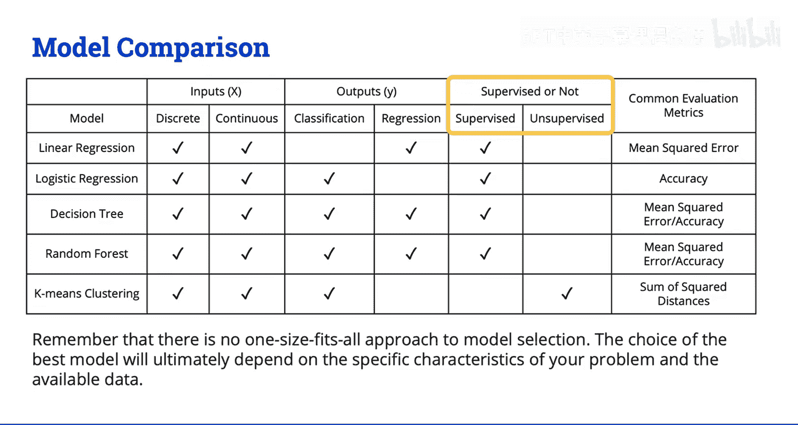

# uPenn《如何运用数据2、3（Python预测分析、数据可视化和叙事）｜How to Use Data》中英字幕 p44 43_模型对比.zh_en [BV1LqxEzcEBy_p44]

Remember that there is no one size fits all approach to model selection。

 The choice of the best model will ultimately depend on the specific characteristics of your problem and the available data。

This table summarizes the different types of inputs and outputs for each model we discussed。

 It also shows whether each model is supervised or unsupervised and the common metrics used for evaluation。

😡。

