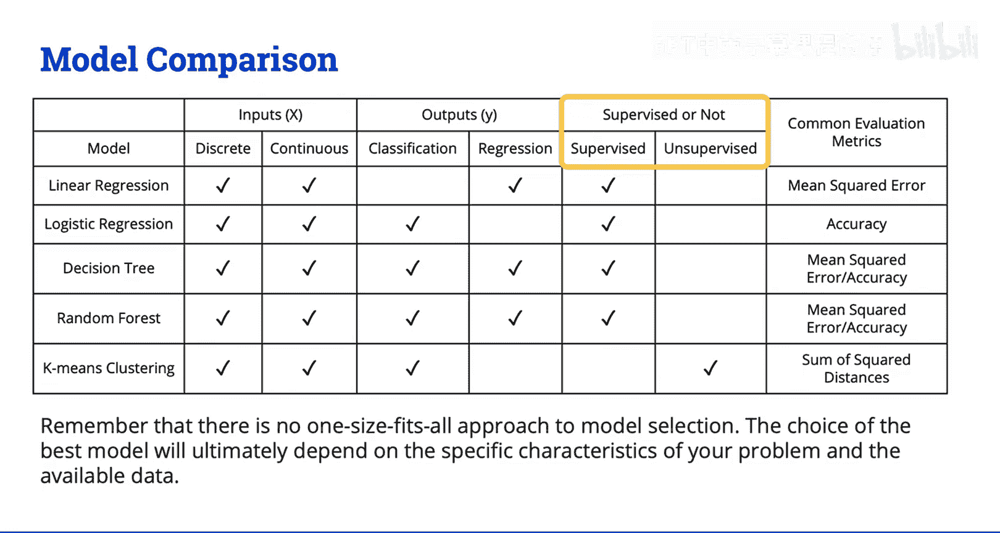

# 数据科学基础：模型对比与选择指南

在本节课中，我们将学习如何对比和选择不同的机器学习模型。我们将回顾几种常见模型的特点、适用场景和评估指标，帮助你理解没有“放之四海而皆准”的最佳模型，选择过程需要结合具体问题和数据特性。

## 核心原则：没有万能模型

模型选择没有一种适用于所有情况的通用方法。最佳模型的选择最终取决于你所要解决问题的具体特征以及可用的数据。

上一节我们介绍了多种模型，本节中我们来看看如何系统地对比它们。

## 模型对比总览

以下表格总结了我们所讨论的每种模型的不同输入和输出类型。它还展示了每种模型属于监督学习还是无监督学习，以及常用的评估指标。

| 模型类型 | 输入 | 输出 | 学习类型 | 常用评估指标 |
| :--- | :--- | :--- | :--- | :--- |
| **线性回归** | 数值型特征 | 连续数值 | 监督学习 | **R²**， 均方误差（MSE） |
| **逻辑回归** | 数值型/类别型特征 | 类别（通常是二元） | 监督学习 | **准确率**， AUC-ROC |
| **决策树** | 数值型/类别型特征 | 类别或连续数值 | 监督学习 | **准确率**（分类）， R²（回归） |
| **随机森林** | 数值型/类别型特征 | 类别或连续数值 | 监督学习 | **准确率**（分类）， R²（回归） |
| **K-均值聚类** | 数值型特征 | 类别（簇标签） | 无监督学习 | **轮廓系数**， 惯性（Inertia） |

## 如何选择模型：关键考量因素

了解了模型的基本对比后，我们来看看在实际选择时需要考虑哪些因素。以下是几个关键的决策步骤：

1.  **定义问题类型**
    *   首先要明确你的目标是**预测一个数值**（回归问题）、**预测一个类别**（分类问题），还是**发现数据中的内在结构**（聚类问题）。

2.  **审视数据特征**
    *   检查数据的特征：是**数值型**居多，还是包含大量**类别型**数据？特征之间是否存在**线性关系**？数据量有多大？是否有**缺失值**？

3.  **评估模型复杂度与解释性**
    *   在**模型复杂度**和**可解释性**之间权衡。例如，线性回归易于解释但可能无法捕捉复杂关系；随机森林预测能力强，但像“黑箱”一样难以理解内部逻辑。

4.  **使用评估指标进行验证**
    *   对于监督学习模型，始终在**测试集**上使用合适的指标（如表格所列）进行评估和比较，避免过拟合训练数据。

## 总结

本节课中我们一起学习了机器学习模型的对比与选择。我们认识到，**不存在一个适用于所有场景的“最佳”模型**。选择过程是一个系统性的决策，需要你：
*   清晰定义问题（回归、分类还是聚类）。
*   深入了解数据特性。
*   在模型性能、复杂度和可解释性之间做出权衡。
*   依靠严谨的评估指标来验证模型在未知数据上的表现。

记住，模型选择是迭代过程的一部分，经常需要尝试多种模型才能找到最适合你特定任务的那一个。