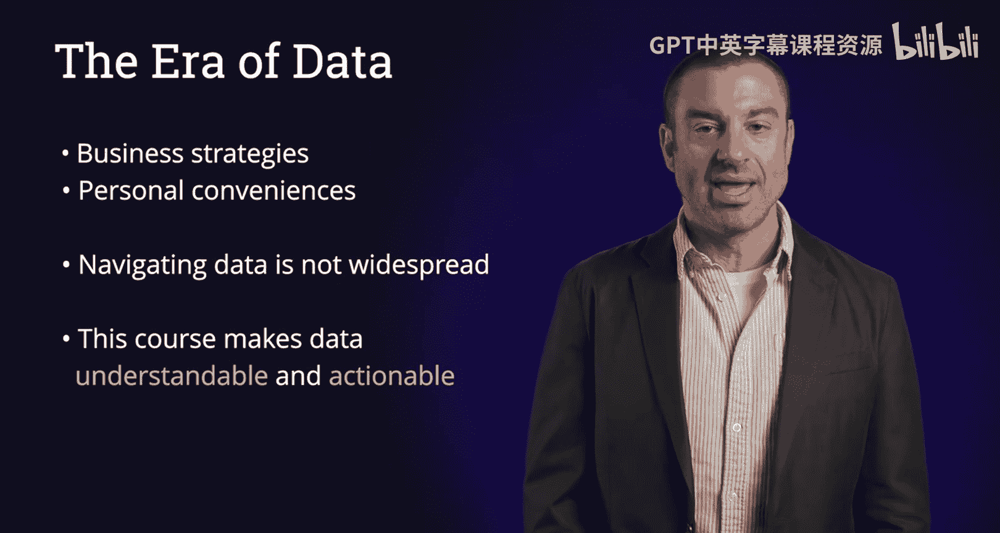

# uPenn《如何运用数据2、3（Python预测分析、数据可视化和叙事）｜How to Use Data》中英字幕 p45 0_如何运用数据专项课程简介.zh_en [BV1LqxEzcEBy_p45]

诶。🎼嗯。🎼In the digital era， data is everywhere， shaping the decisions we make daily。

 It's transforming industries， driving innovation and creating new opportunities。

 Welcome to our Coursera specialization， how to use data。

 a pivotal gateway designed for anyone eager to harness the potential of data。

 regardless of prior experience。 The journey into data begins here。

 where you unlock the fundamentals of data analysis， data science and data analytics。

 This specialization is your comprehensive guide through the evolving landscape of data。

 offering practical skills and insights that remain relevant as technology progresses。

We live in an era where data touches every corner of our existence。

 from the way businesses strategize to the smallest personal convenience。

 data is the unseen force shaping our world， yet despite its prevalence。

 the ability to navigate this vast sea of information is still not widespread。

This specialization bridges that gap， offering you the tools to make data not just understandable but actionable。

 it's about turning information into insight and insight into impact。

Data Analas。