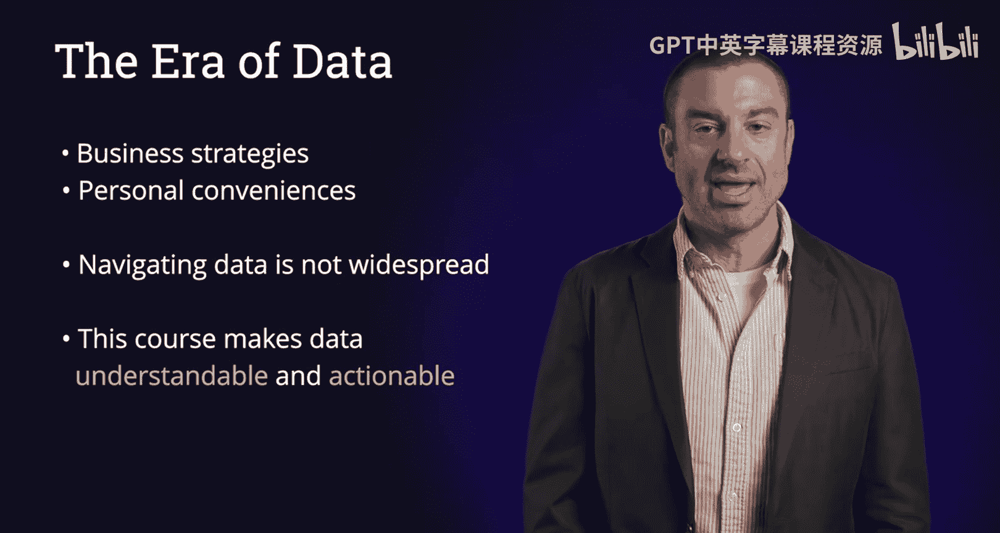

# 如何运用数据专项课程：0：专项课程简介

在本节课中，我们将要学习宾夕法尼亚大学“如何运用数据”专项课程的核心内容与目标。本课程旨在为所有希望掌握数据潜力的人提供一个关键的入门途径，无论其先前经验如何。

## 概述：数据无处不在的时代

我们生活在一个数据触及我们存在各个角落的时代。从企业的战略制定到微小的个人便利，数据是塑造我们世界的一股无形力量。然而，尽管数据无处不在，驾驭这片广阔信息海洋的能力仍未普及。

本专项课程旨在弥合这一差距，为您提供工具，使数据不仅可理解，而且可付诸行动。其核心在于将信息转化为洞察，再将洞察转化为影响力。

## 课程核心内容

上一节我们介绍了数据时代的背景，本节中我们来看看本专项课程将具体涵盖哪些关键技能领域。

以下是本课程将引导您掌握的三个核心技能模块：

1.  **数据分析基础**：您将在此解锁数据分析、数据科学和数据分析的基础知识。
2.  **Python预测分析**：学习使用Python进行数据预测，这是数据科学中的一项关键技能。
3.  **数据可视化与叙事**：掌握将数据洞察通过可视化的方式清晰呈现，并构建有说服力数据故事的能力。

本专项课程是您在不断演变的数据领域中的全面指南，提供实用的技能和见解，这些内容将随着技术进步而保持其相关性。

## 总结

本节课中我们一起学习了“如何运用数据”专项课程的定位与核心内容。它专为渴望驾驭数据潜力的人设计，是一个综合性的实践指南，帮助您将信息转化为切实的洞察与行动。数据之旅，从此开始。