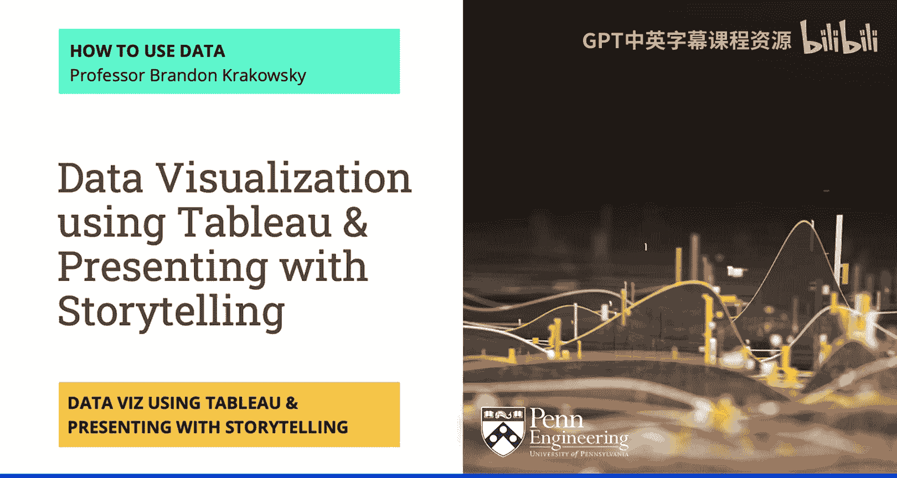
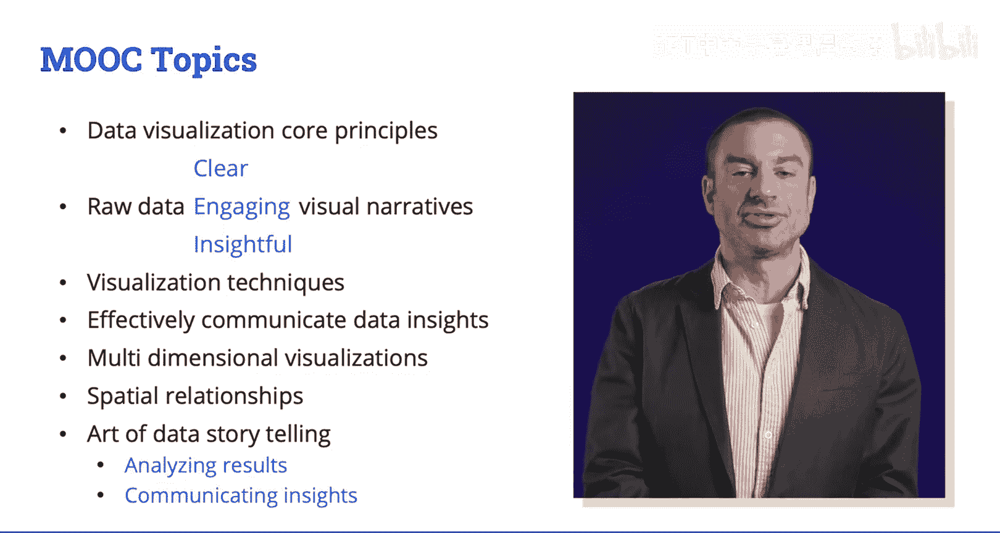

# uPenn《如何运用数据2、3（Python预测分析、数据可视化和叙事）｜How to Use Data》中英字幕 p46 1_使用Tableau进行数据可视化及叙事化呈现课程简介.zh_en [BV1LqxEzcEBy_p46]

This course takes you on a detailed exploration of data visualization using Tableau。

 an industry leading tool for creating rich and interactive data visualizations。😡，Additionally。

 the course highlights the crucial skills of insight presentation and the crafting of compelling data narratives。

😡。

Beginning with the core principles of effective data visualization。

 this course equips you with the knowledge to transform raw data into clear， engaging。

 and insightful visual narratives。You'll learn how to employ various visualization techniques。

 ranging from simple one dimensional charts to complex visualizations that reveal intricate data relationships and patterns。

😡，Each module is designed to build upon the last， ensuring you gain a comprehensive understanding of how to effectively communicate data insights。

😡，As we progress， you'll delve into advanced topics。

 including multidimensional visualizations and the visualization of spatial relationships。

 which are crucial for analyzing and presenting data from multiple tables and diverse sources。

The course also focuses on the art of data storytelling。

 a skill that combines analytical rigor with creativity to craft stories that not only inform but also engage and persuade your audience。

 will cover the best practices for analyzing results。

 creating compelling data analytics presentations and communicating insights in a way that's accessible to stakeholders。

By the end of this course， you'll be adept at the nuanced craft of data visualization with Tau and data storytelling。

 preparing you to effectively present your analysis and findings。😡。

This expertise is indispensable for data professionals aiming to enhance their presentation skills and drive action through powerful data driven narratives。

😡。

