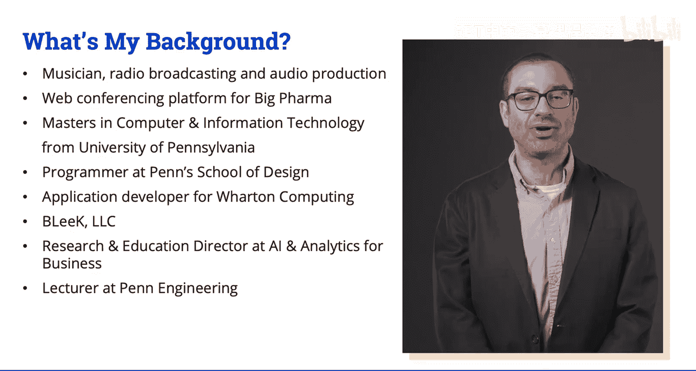

# uPenn《如何运用数据2、3（Python预测分析、数据可视化和叙事）｜How to Use Data》中英字幕 p47 2_讲师简介.zh_en [BV1LqxEzcEBy_p47]

🎼嗯。Hi， my name is Brandon Kraowski， and I'm the instructor for this。

 How to use data course For a bit of background。 I started out as a musician， then worked in radio。

 broadcastcasting and audio production。 My experience in programming began with Adobe flash a tool I used to develop a live web conferencing platform for big pharma。

😊。

I received my master's in computer and information technology from the University of Pennsylvania around 2009。

 then worked as a programmer at Penn School of Design。

I then worked as an application developer for Wharton computingut。

 working with faculty and staff to build technology to advance student programs somewhere in the middle of all that。

 I started my own company，bleak LLC， doing programming and freelance application development for a variety of companies。

 I transitioned into data and analytics and became the research and education director at AI and analytics for business and in 2018。

 I became a lecturer at Penn engineering。

A bit more about me。 I'm a bass player。 I've been playing bass for many years。

 I play a variety of styles， but prefer music on the funkiier side。

 I recently cut way down on coffee and learned to spend more time meditating。 Most of all。

 I'm a family man。

This course is for students and professionals with minimal or no prior knowledge of or experience with data or working with data or with data analytics。

 while the course does require experience with programming。

 it does not require any background in doing data analysis， data science or data visualization。

 generally speaking， this course is an excellent introduction for those who want to learn about the mechanics of data。

 performing data analysis to gain insights， applying data science techniques to make predictions and applying data analytics to answer questions and to address interesting business problems。

😡。

