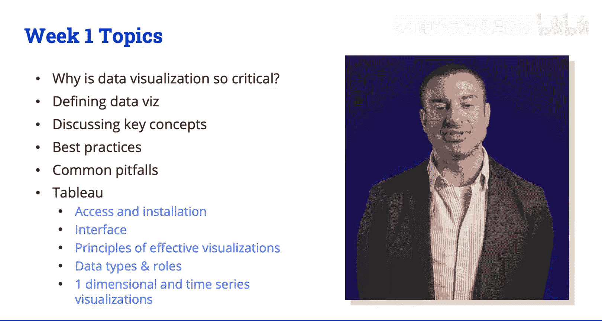

# uPenn《如何运用数据2、3（Python预测分析、数据可视化和叙事）｜How to Use Data》中英字幕 p48 3_模块一导论：数据可视化与Tableau.zh_en [BV1LqxEzcEBy_p48]

Welcome to the first module of the course where we dive into the world of data visualization and its implementation through Tableau。

 a leading tool in the industry。 This module begins with an exploration of why data visualization is critical in today's data driven decision making processes。

 defining what data visualization is and discussing its key concepts。😡。

We'll examine a variety of tools available for data visualization。

 focusing on best practices and common pitfalls to avoid。

A significant part of this module is dedicated to introducing you to Tableau。

 providing guidance for how you can access and install it， and how to navigate its interface。😡。

We'll cover the principles of effective visualizations， different data types and roles。

 and moving towards creating one dimensional and time series visualizations。😡。

By the end of this module， you'll have a solid understanding of the fundamentals of data visualization and be able to use Tableau to turn data into basic。

 yet compelling visualizations。😡。