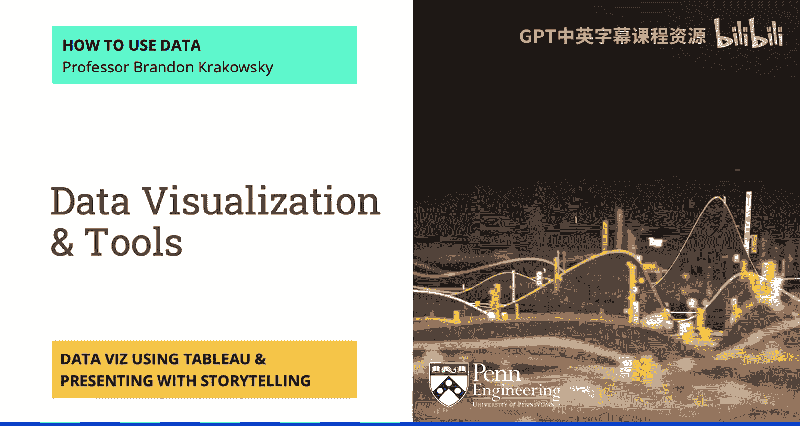

# uPenn《如何运用数据2、3（Python预测分析、数据可视化和叙事）｜How to Use Data》中英字幕 p49 4_数据可视化及其工具.zh_en [BV1LqxEzcEBy_p49]

Data visualization is essential for several reasons。

It allows for efficient comprehension and interpretation of large volumes of data。

It reveals patterns， trends and correlations that might be hidden in raw data。

 It makes it easy for individuals without prior knowledge or expertise to understand complex data。

It facilitates deeper insights and informed decision making。 Finally， it tells compelling stories。

 supports arguments， and drives impactful discussions。

These points illustrate the importance of data visualization in facilitating understanding。

 decision making， communication， and deriving actionable insights from complex data。

So what is data visualization， It's representing data in a visual format， such as charts and graphs。

 maps。Or diagrams to convey information effectively。

Here are other key concepts of data visualization， visual encoding。

 which refers to the mapping of data variables to visual properties like position， length， color。

 shape or size。 This encoding helps in representing data attributes and facilitating comparisons。😡。

Exploratory versus Expplanatory visualizations。 Exploratory visualizations are used for data exploration and analysis。

 allowing users to discover patterns and insights。 Expplanatory visualizations are designed for communication。

 presenting data and insights to an audience and storytelling。

Data visualization can incorporate storytelling techniques to engage viewers。

 guide them through the data， and convey a narrative that supports the intended message。

There are numerous tools available for data visualization and analysis。

 varying in complexity and suitability。 good data visualization skills transcend specific tools。

 So focus on best practices and personal style。Build a foundation of analysis and storytelling that can be applied regardless of the tools or software used。

 Tableau is a widely used data visualization tools that offers a range of intuitive features and a drag and drop interface。

 It allows users to create interactive dashboards， charts。

 maps and reports from various data sources。😡，Power BI is a Microsoft Business Inlig tool that enables users to visualize data and share insights across organizations。

It offers interactive visualizations， data modeling， and collaboration features。😡。

There are many packages available in Python to do data visualization。 If you recall。

 we looked at some of these packages when visualizing data in Python， for example， Mattplloot。

 Libb and Seaborn， and there are others such as Ply and Ggiplloot。😡，In this module。

 we'll be focusing on visualizing data with Tableau。😡。

In terms of best practices of data visualization， understand your audience。

 this means you should tailor your visualizations to meet the specific needs of your audience。

 considering their expertise and desired insights。😡，Simplify and declutter。

 meaning keep your visualizations clean and concise。

 avoiding unnecessary decorations or overwhelming amounts of data。 Use appropriate chart types。

 This means you should select the most suitable chart types to effectively represent the data and support your analysis or communication goals。

 Finally， consistently。 Use colors consistently across your visualizations to represent similar data categories or attributes。

😡，Now let's look at some of the worst practices of data visualization。Missrepresenting data。

 This means using data visualization to manipulate or distort the narrative， for example。

 presenting an inaccurate or misleading visualization， which could lead to incorrect conclusions。

Can you tell which visualization is better？The left one is better because we see the full range of possible exam grades。

Another example of bad practice is overloading your visualizations with complex decorations。

 making it difficult for the audience or shareholders to understand。

Can you tell the intended message of this visualization。This shows sales and profits by product name。

 but it's very difficult to understand。Another bad practice is selecting unsuitable chart types to ineffectively represent the data。

 making it harder for viewers to read。 Can you tell the intended message of this visualization。

This shows the average order per unit shipment per order date， but it uses an unsuitable chart type。

 A bar chart would be a better choice。Lack of consistency and coherence is also bad practice。

Visualizations within a report or dashboard should maintain consistency in terms of labeling， colors。

 styles， and formats。If not， the viewers will have a difficult time comparing and interpreting the data。

 Is the style of these two charts the same， No， the two charts use distinct color sets。

How about these two， Yes， the two charts are stylistically consistent as they use the same color sets。

Tabableau is a visual analytics platform or a data visualization tool used for data analysis and business intelligence。

Tabableau is one of the most popular business intelligence and data visualization tools today。

It allows for visualizing data and communicating data related insights and findings through charts。

 graphs， maps， dashboards， and Tableau stories。 Tableau offers free one year licenses to students at accredited academic institutions through their Tableau for students program at this URL。

😡，The one year license is all you'll need for working on the exercises in this course。

