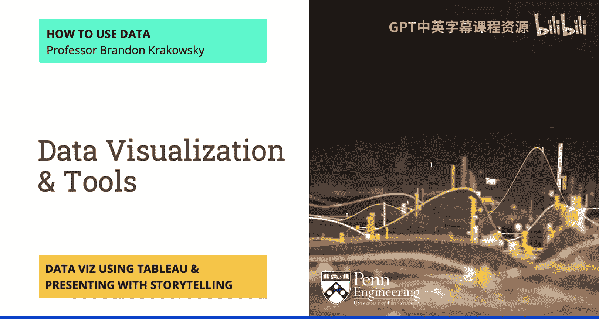
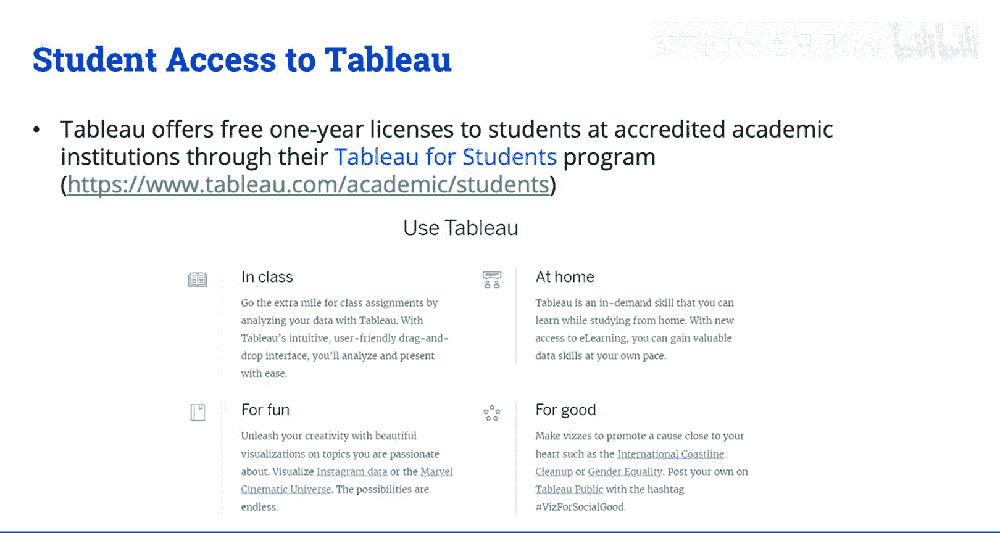

# 数据可视化及其工具：4：数据可视化基础与工具介绍

在本节课中，我们将学习数据可视化的核心概念、重要性、最佳实践以及常用工具。数据可视化是将数据转化为图形或图表的过程，旨在帮助人们更直观、更高效地理解复杂信息。

## 概述

数据可视化对于理解和沟通数据至关重要。它不仅能揭示数据中的模式和趋势，还能支持决策并驱动有影响力的讨论。本节将介绍数据可视化的定义、关键概念、工具选择以及应遵循的最佳实践。

## 数据可视化的重要性

数据可视化之所以重要，主要有以下几个原因。

它允许高效地理解和解释大量数据。
它能揭示原始数据中可能隐藏的模式、趋势和相关性。
它让不具备专业知识的人也能轻松理解复杂数据。
它有助于获得更深入的见解并做出明智的决策。
最后，它能讲述引人入胜的故事、支持论点并推动有影响力的讨论。

这些要点阐明了数据可视化在促进理解、决策、沟通以及从复杂数据中获取可操作见解方面的重要性。

## 什么是数据可视化？

数据可视化是以视觉格式（如图表、图形、地图或图表）表示数据，以有效地传达信息。

## 数据可视化的关键概念

以下是数据可视化的其他关键概念。

*   **视觉编码**：指将数据变量映射到视觉属性，如位置、长度、颜色、形状或大小。这种编码有助于表示数据属性并促进比较。
*   **探索性可视化与解释性可视化**：探索性可视化用于数据探索和分析，允许用户发现模式和见解。解释性可视化则专为沟通而设计，用于向观众展示数据和见解，并用于讲故事。
*   **叙事性**：数据可视化可以融入讲故事技巧，以吸引观众，引导他们理解数据，并传达支持预期信息的叙述。

## 数据可视化工具

有多种工具可用于数据可视化和分析，其复杂性和适用性各不相同。优秀的数据可视化技能超越特定工具。因此，应专注于最佳实践和个人风格。建立分析和叙事的基础，无论使用何种工具或软件都能应用。

以下是几种常用工具。

*   **Tableau**：一种广泛使用的数据可视化工具，提供一系列直观功能和拖放界面。它允许用户从各种数据源创建交互式仪表板、图表、地图和报告。
*   **Power BI**：一种微软商业智能工具，使用户能够在组织内可视化数据和共享见解。它提供交互式可视化、数据建模和协作功能。
*   **Python 库**：Python 中有许多可用于数据可视化的包。例如，`Matplotlib`、`Seaborn`，以及其他如 `Plotly` 和 `ggplot`。

在本模块中，我们将重点学习使用 Tableau 进行数据可视化。

## 数据可视化最佳实践

上一节我们介绍了数据可视化的工具，本节中我们来看看如何有效地使用这些工具。遵循最佳实践至关重要。

以下是关键的最佳实践。

*   **了解你的受众**：这意味着你应该根据受众的具体需求定制可视化内容，考虑他们的专业知识和期望的见解。
*   **简化与去杂乱**：保持可视化内容简洁明了，避免不必要的装饰或过多的数据。
*   **使用合适的图表类型**：选择最合适的图表类型来有效地表示数据，并支持你的分析或沟通目标。
*   **保持一致性**：在你的可视化内容中一致地使用颜色来表示相似的数据类别或属性。

## 数据可视化应避免的做法

现在，让我们看看数据可视化中一些应避免的做法。

*   **歪曲数据**：这意味着使用数据可视化来操纵或扭曲叙述，例如，呈现不准确或误导性的可视化，这可能导致错误的结论。你能分辨哪个可视化效果更好吗？左边那个更好，因为我们看到了考试分数的完整范围。
*   **过度装饰**：用复杂的装饰使可视化内容过载，使受众或利益相关者难以理解。你能说出这个可视化的预期信息吗？它按产品名称显示了销售额和利润，但非常难以理解。
*   **选择不合适的图表类型**：选择不合适的图表类型来低效地表示数据，使观众更难阅读。你能说出这个可视化的预期信息吗？它显示了每个订单日期的平均订单单位发货量，但使用了不合适的图表类型。条形图会是更好的选择。
*   **缺乏一致性和连贯性**：报告或仪表板中的可视化内容应在标签、颜色、样式和格式方面保持一致。否则，观众将难以比较和解释数据。这两个图表的样式相同吗？不，这两个图表使用了不同的颜色集。那这两个呢？是的，这两个图表在风格上是一致的，因为它们使用了相同的颜色集。

## 关于 Tableau

Tableau 是一个可视化分析平台或数据可视化工具，用于数据分析和商业智能。Tableau 是当今最流行的商业智能和数据可视化工具之一。它允许通过图表、图形、地图、仪表板和 Tableau 故事来可视化数据并传达与数据相关的见解和发现。Tableau 通过其 Tableau for Students 计划，为认可学术机构的学生提供为期一年的免费许可证（访问此 URL）。这一年的许可证足以满足你在本课程练习中的所有需求。

## 总结

本节课中我们一起学习了数据可视化的基础知识。我们了解了数据可视化的重要性在于高效传达信息、揭示模式并支持决策。我们探讨了其核心概念，如视觉编码和不同类型的可视化目的。我们还介绍了包括 Tableau、Power BI 和 Python 库在内的主要工具，并强调了遵循最佳实践（如了解受众、保持简洁和一致性）以及避免常见错误（如歪曲数据和选择不当图表）的重要性。掌握这些原则是进行有效数据沟通的关键。