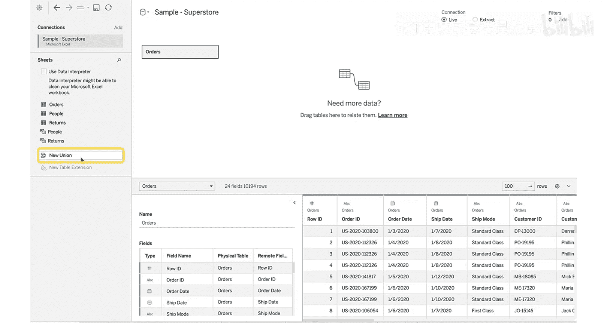
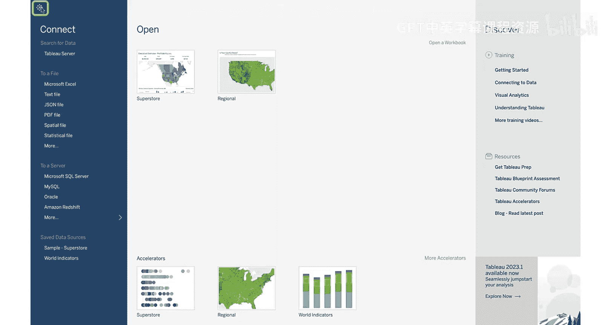
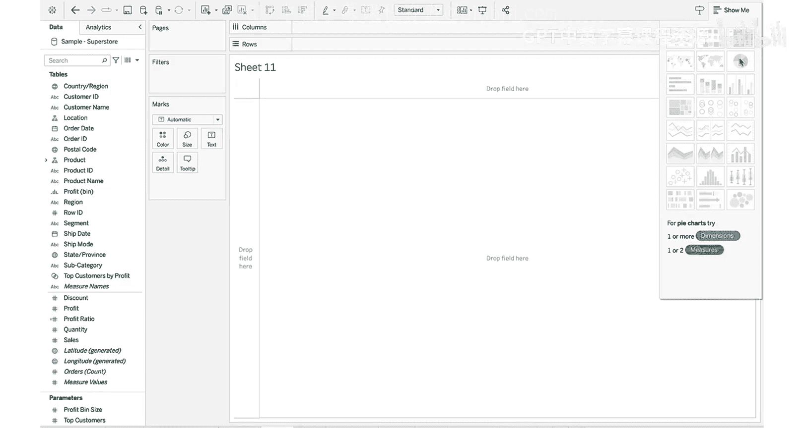

# uPenn《如何运用数据2、3（Python预测分析、数据可视化和叙事）｜How to Use Data》中英字幕 p50 5_编程演示：Tableau界面导览.zh_en [BV1LqxEzcEBy_p50]

So in this demo， we'll introduce the tableau interface and how to navigate the different features。

 When you first launch Tableau public。 This is the view that you'll see by default。

 There are a variety of ways you can load and access data within Tableau。

 We have the connect section on the left。 which has options for connecting to a data source。

 So your data set can be a file such as Excel， Json。

 Pf or some other file format And you can also connect to a server or MysQl and Athena and many other options as well。

 We'll be making use of the sample superstore data a lot in these demos because it's what the official documentation revolves around。

 to access the sample superstore data set， We've provided a downloadable Excel file from within Coursera。

 Once you've downloaded that data file to your local computer。

 click Microsoft Excel from within the connect pane in tableableau。😊，Locate the Excel file。

Then click open， This will open the data in the tab below data source view。

 Dr and drop individual sheets in the left pane onto the workspace。 Start with the order sheet。

Then drag the additional sheets near the order sheet to relate them。

So we're going to drag over the people sheet。We're also going to drag over the return sheet。

Tabableau will relate them to orders。When you're done。

 click the first tab low sheet in the lower left。 Once you do that， you're inside this view here。

 This is where you'll be working most， creating your visualizations。So over here。

 you can see the data。 This entire section right here is my data pane。 It comprises my dimensions。

 my measures and the parameters that I have created。

 We'll talk a lot about these throughout the course。 And if you click on analytics here。

 it shows the analytics pane。 We have options to summarize model and other custom options。

 Aside from that， we have marks here。 This is called the Marx card。 We have color。

 size and text options on it。 We'll be using the markx card。

 whenever we want to perform some kind of formatting or other options。

We have the filter shelf right here as well。 So if you want to filter out certain data from your visualizations。

 We'll just drag it over here to work with it and customize the filter。 We have the pages shelf。

 which we won't be using too much。 And then we have the column shelf and the row shelf。

 So if I drag something here onto the column shelf， it'll basically form my columns。

 and then if I drag something else onto my row shelf， it'll form my rows and my visualization。

 And this white area right here is my visualization view。

 So if I just take the segment dimension and drag it onto my column shelf right here。

 I can see that it's forming my columns。 And then if I take the sales measure and drag it onto my row shelf。

 I can see that it's forming my rows。 And then I could see my visualization here in this view。

 And then I have the status bar right here， which is showing me that I have three marks in my view right now。

 So consumer is the first mark corporate is the second one and then home office is the third one。

 If I want to create a new sheet， I can use this button right here。

 If I want to create a new dashboard。But and if I want to create a new story。

 then this button over here。Apart from that， I can see that I have a lot more options on top over here so you can either sort your data into descending order。

 which it already is， or an ascending order using this button。

And then you can even swap your rows and columns with the single click of a button using this one right here so you can see that my rows became my columns and my columns became my rows。

 So I'm just going to click this again and flip it back。And then you have this T button right here。

 which is amazing， shows show mark labels。So once I click on that。

 I can see the sales value on top of all these bars as well。

So if you want to see the text in your view， just click on this button。

 you'll be able to see the value of the measures。And then if you just want to clear your entire view。

 just click on this button， which has clearear sheet。And I can see that everything has been removed。

 and my view is empty now。 So as my column shelf and my rose shelf and the marks card。

 everything is empty。Apart from that， I could see that I have all these options right here。

On top in my menu。So we'll be talking a lot more about them throughout the course， but if you want。

 let's say to perform some sort of formatting， you can either come here or we can even do it from the Marx card。

But formatting from here is much more powerful because you have so many more options。

Here you can see the data source you're connected to right now。

 so you could just right click and let's say view data and you can see your data set。

So these are all your rows。And then you can even click on this button which says view data so you get the exact same thing。

And then you can even go to your data source over here。 This is my data source。

 which is the sample superstore data set， as we discussed。 And then from the sample superstore。

 these are my sheets。So orders， people， returns。I've taken orders and then dragged it over here。

 So Tableau has done this by default。 And you're viewing the data for the orders table right now。

So all these columns and all these rows， I'm using a live connection by default。

 and you can click on this button to create an extract as well。

 We'll discuss the difference between live and extract and a future demo。

You can even refresh your data source so if you have any changes in your data source。

 just click on this and Tableau will refresh your data A apart from that。

 if you want to create a union， you could do it from here， but we'll talk about that separately。

Click on this button， and then we're exactly where we started from。

And then you can click this right here and click over here on an empty sheet。

So the showmi tab right here is also important because it's showing you the different types of visualizations that you can create。

 So let's see a pie chart， And it's also telling you how many dimensions or measures you need to create this type of visualization in Tableau。

 So that's very helpful for us， especially if you're confused in terms of how many dimensions and or measures you need。

 We'll be talking much more about the different types of visualizations and many other concepts in Tableau。

So hope this helps get you started。 Let's continue with the rest of the course。

