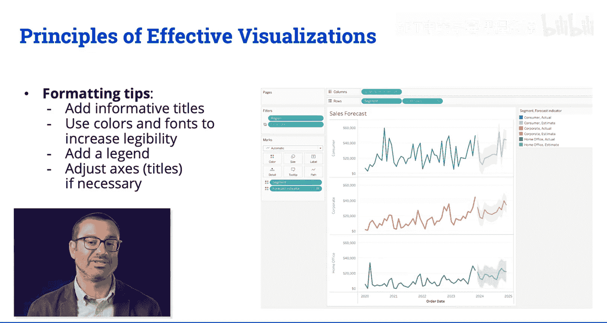

# uPenn《如何运用数据2、3（Python预测分析、数据可视化和叙事）｜How to Use Data》中英字幕 p51 6_数据可视化的概念与原理.zh_en [BV1LqxEzcEBy_p51]

In Tableau， data types specify the datas format， while data roles guide how that data is utilized and displayed in visualizations and analysis。

😡，Data types define the format in which data is stored in a field and processed。

Examples of common data types include integers， which are whole numbers。Floats are doubles。

 which are decimal numbers。Strings or text， which are sequences of characters and Booleions。

 which are two or false values。Correct data types ensure accurate calculations in comparisons。

 When you import or connect to data， Tableau automatically assigns a data type to each field。😡。

But you can reassign data types as needed。Data roles specify how a field in a data set should be used in visualizations and calculations。

Common data roles include dimensions， which are categories for grouping and measures。

 which are quantitative data。 Assing the right data role enhances visualization。

 accuracy and analysis。 When you import or connect to data。

 Tableau automatically assigns a data role to each field。 But you can reassign data roles as needed。

 Let's look at data roles in more detail and how they're represented in the tableableau interface。

Dimenssions contain distinct values that can be used to categorize or segment data。

 and measures contain numeric， quantitative values that you can measure or aggregate。Usually。

 a discrete dimension or measure is blue， and a continuous dimension or measure is green。

 A discrete dimension is more common and colored in blue。

 It represents a finite amount of distinct and separate values。 Typically。

 these values are not aggregated。 For example， imagine we have data containing customer orders of particular products。

 The ship mode， ship status and product I D fields would all be considered discrete dimensions。

On the other hand， a continuous dimension is less common and colored in green。

It represents an infinite amount of distinct and separate values that fall along a continuous scale。

 For example， date， sales and profit fields in a data set could all be considered continuous dimensions。

A discrete measure is also less common and colored in blue。

 it represents a finite amount of quantitative values that can be countered or measured in distinct separate units。

These values are often aggregated， for example， account of quantities。

 people or returns could all be considered discrete measures。On the other hand。

 a continuous measure is more common and colored in green。

 It represents an infinite amount of quantitative values that can be measured along a continuous scale。

 For example， if we have location data， the latitude and longitude fields would be considered continuous measures。

 Note， it's not always obvious if a field should be considered a discrete dimension or measure or a continuous dimension or measure。

 Oftentimes， data fields can play different roles depending on how we want to visualize the data。

Here are some basic ways to enhance your visualization in tableau。

 One is using reference lines in your visualization。

 Here we see a reference line depicting the average sales across all states and provinces。

Another is using trend lines Here we see a trend line for customer sales and profit。

Tabableau also makes it very easy to show forecasting。Here we see a forecast of sales per month。

Here are several tips for formatting your visualizations in Tau， add informative titles。

 use colors and fonts to increase legibility。😡，At a legend。Adjust axes or titles if necessary。

 create tool tipsips。😡。

