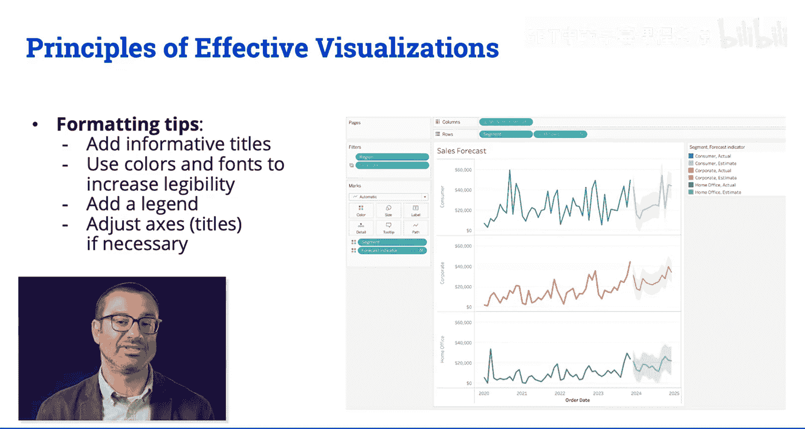

# 数据可视化：第6章：数据可视化的概念与原理

在本节课中，我们将学习Tableau中数据可视化的重要基础概念，包括**数据类型**与**数据角色**的定义、区别及其在可视化中的应用。掌握这些概念是创建有效、准确图表的关键。

## 数据类型与数据角色概述

上一节我们了解了数据可视化的基本价值。本节中，我们来看看构建可视化图表前必须理解的两个核心概念：数据类型和数据角色。

在Tableau中，**数据类型**指定了数据的存储格式，而**数据角色**则指导该数据在可视化和分析中如何被使用和展示。

### 数据类型

数据类型定义了字段中数据的存储和处理格式。

以下是常见的数据类型示例：
*   **整数**：代表整数。
*   **浮点数**：代表带小数点的数字。
*   **字符串或文本**：代表字符序列。
*   **布尔值**：代表真或假两种值。

正确的数据类型能确保计算和比较的准确性。当你导入或连接数据时，Tableau会自动为每个字段分配一个数据类型，但你也可以根据需要重新分配。

### 数据角色

数据角色指定了数据集中某个字段在可视化和计算中应如何使用。

常见的数据角色包括：
*   **维度**：用于分组和分类的数据。
*   **度量**：用于定量分析的数据。

分配正确的数据角色可以提升可视化的准确性和分析深度。当你导入或连接数据时，Tableau会自动为每个字段分配一个数据角色，但你同样可以根据需要重新分配。

## 数据角色的深入解析

理解了基本定义后，让我们更详细地看看数据角色，以及它们在Tableau界面中是如何表示的。

维度包含可用于分类或细分数据的独立值，而度量包含可以测量或聚合的数值型定量数据。通常，**离散**的维度或度量显示为蓝色，**连续**的维度或度量显示为绿色。

以下是不同类型数据角色的具体说明：

*   **离散维度**：这是更常见的情况，显示为蓝色。它代表有限数量的、独立且不同的值。这些值通常不会被聚合。例如，在包含客户产品订单的数据中，“运输方式”、“运输状态”和“产品ID”字段都可被视为离散维度。
*   **连续维度**：这种情况较少见，显示为绿色。它代表沿着连续尺度分布的、无限数量的不同值。例如，数据集中的“日期”、“销售额”和“利润”字段都可被视为连续维度。
*   **离散度量**：这种情况也较少见，显示为蓝色。它代表可以按独立、分离的单位进行计数或测量的有限数量的定量值。这些值经常被聚合。例如，“数量计数”、“人数”或“退货数”都可被视为离散度量。
*   **连续度量**：这是更常见的情况，显示为绿色。它代表可以沿着连续尺度测量的、无限数量的定量值。例如，如果我们有地理位置数据，“纬度”和“经度”字段就可被视为连续度量。

需要注意的是，一个字段应该被视为离散维度/度量还是连续维度/度量，并非总是显而易见。很多时候，数据字段可以根据我们想要的可视化方式扮演不同的角色。

## 增强可视化的基本方法

掌握了数据的基础概念后，我们来看看在Tableau中增强图表表现力的一些基本技巧。

以下是几种提升可视化效果的方法：
*   **使用参考线**：在可视化中添加参考线，可以标示关键基准。例如，一条显示所有州/省平均销售额的参考线。
*   **使用趋势线**：添加趋势线可以揭示数据模式。例如，显示客户销售额与利润关系的趋势线。
*   **显示预测**：Tableau可以轻松生成预测。例如，显示未来每月的销售额预测。

## 可视化格式化的技巧

最后，为了使图表更清晰、更专业，适当的格式化至关重要。

以下是格式化可视化图表的一些实用技巧：
*   添加信息丰富的标题。
*   使用颜色和字体来提高图表的可读性。
*   添加图例。
*   在必要时调整坐标轴或标题。
*   创建提示工具。

本节课中，我们一起学习了Tableau数据可视化的核心原理。我们明确了**数据类型**与**数据角色**（特别是**离散**与**连续**的区别）是构建图表的基础，并介绍了几种增强和美化可视化的实用方法，包括使用参考线、趋势线以及进行恰当的格式化。理解这些概念是迈向有效数据叙事的第一步。