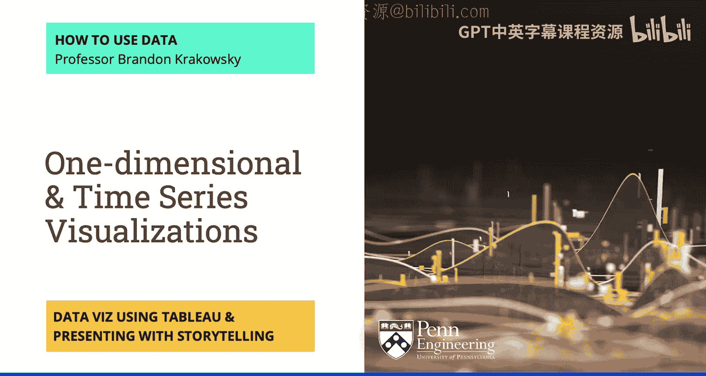
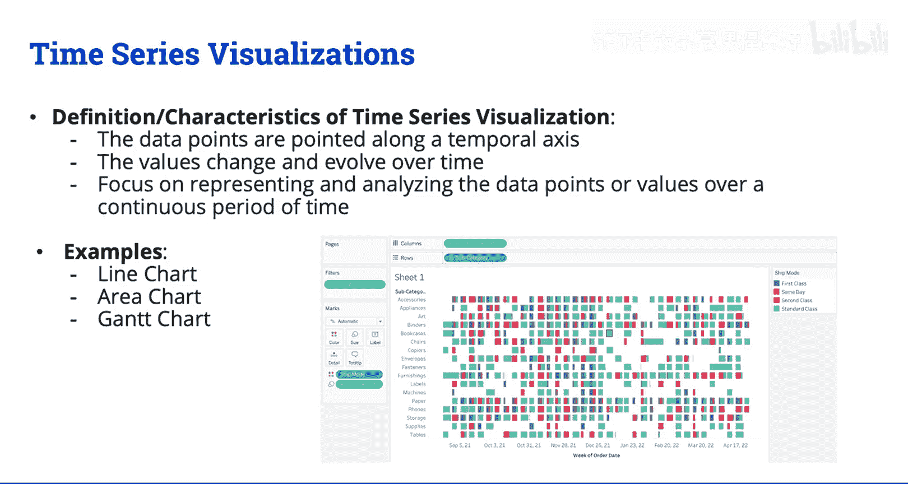

# uPenn《如何运用数据2、3（Python预测分析、数据可视化和叙事）｜How to Use Data》中英字幕 p52 7_单维与时间序列可视化.zh_en [BV1LqxEzcEBy_p52]

For a one dimensional visualization， the data is typically represented along a single axis。

 and the values are plotted or displayed along that axis。 The length。

 height or position of the visual elements， the bars or lines represent the magnitude or value of the data points。

Here are some one dimensional visualizations， bar charts。

 which are one of the most common data visualizations。

 You can use them to compare data across categories。 For example， in this visualization。

 we see total profit across segments。😡，Line charts or line graphs connect several distinct data points。

 presenting them as one continuous evolution。You can use these line charts to view trends in data。

 usually over time。 For example， this visualization shows total quantity of orders per year。😡。

Histograms show data distributed across distinct groups。

 Histograms group your data into specific categories or bins。

 then assign a bar that is proportional to the number of records in each category。 For example。

 this histogram shows profit counts in bins or ranges of different profit amounts。And pie charts。

 which are great for adding detail to other visualizations。

 pie charts can help to drill down on other information。

 These example pie charts show a breakdown of specific product categories。

For a time series visualization， the data points are pointed along a temporal axis。

 and the values change and evolve over time。These visualizations focus on representing and analyzing the data points or values over a continuous period of time。

Here are some time series visualizations line charts again， in this example。

 we see the total quantity of orders per year。😡，Area charts。

 which are line charts where the area between the line and the axis are shaded with a color。

These charts are typically used to represent accumulated totals over time。

This example shows total sales per quarter。And Gt charts。

 which typically display a project schedule or show changes in activity over time。😡。

This Gt chart shows shipping modes over time for different product subcategories。

