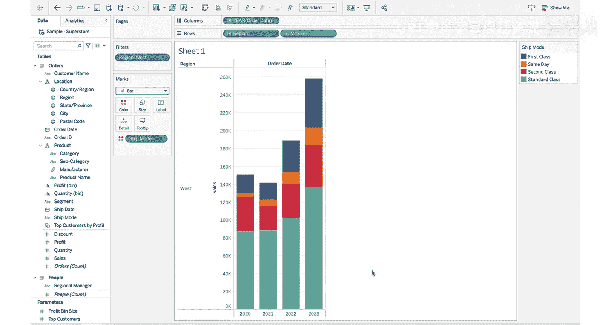

# uPenn《如何运用数据2、3（Python预测分析、数据可视化和叙事）｜How to Use Data》中英字幕 p53 8_编程演示：单维可视化之条形图.zh_en [BV1LqxEzcEBy_p53]

Okay。

This section has step by step exercises that walk you through building different types of charts using real data。

 You'll be working with the sample superstore data source， which comes with Tableau desktop。

Keep in mind that the examples provided here are just a taste of the wide variety of data views that you can create in Tableau。

 First， we're going to talk about bar charts， Use bar charts to compare data across categories。

You create a bar chart by placing a dimension on the row shelf and a measure on the column shelf or vice versa。

A bar chart uses the bar mark type to create a bar chart that displays total sales for a four year period。

 Follow these steps。 First， make sure you're connected to the sample superstore data source。

Drag the order date dimension to columns。😡，And drag the sales measure to Rose。

Notice that the data is aggregated by year and column headers appear。

The sales measure is aggregated as a sum， and an axis is created while the column headers move to the bottom of the view。

Tableau uses line as the mark type because you added the date dimension。On the Mars card。

 select bar from the dropropdown list。The view changes to a bar chart。 The marks。

 which are bars in this case， are vertical because the axis is vertical。

 The length of each mark represents the sum of the sales for that year。Note。

 the actual numbers you see here in the demo might not match the numbers you see in your visualization as the sample data changes from time to time。

Drag the ship mode dimension to color on the marks card。

 The view shows how different shipping modes have contributed to sales over time。

 The ratios look consistent from year to year。You can add additional fields to the shelves。

 drag the region dimension to rows， and drop it to the left of sails to produce multiple axes for sales by region to view data in the west region only。

 you can filter out the other regions。To do this， drag the region dimension again this time from the data pane to the filter shelf and the filter dialog box。

 clear the central east and south check boxes and then click O。

 This view gives you insight into your data。 For example。

 how the ship mode changed in the west over the four year period。

