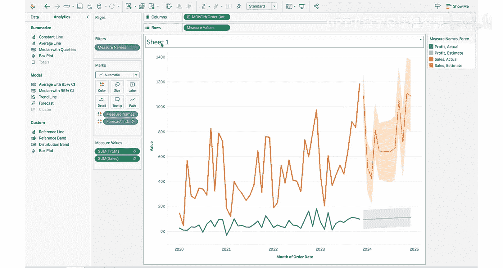

# uPenn《如何运用数据2、3（Python预测分析、数据可视化和叙事）｜How to Use Data》中英字幕 p54 9_编程演示：单维可视化之折线图.zh_en [BV1LqxEzcEBy_p54]

Let's clear this sheet。 Now， we're going to introduce how to build line charts。

 Line charts are like dots connected with lines。 They're handy when you want to see how things change over time or make predictions about the future。

So if you're curious about trends or want to forecast values。

 line charts are your go to tool to create a view that displays the sum of sales and the sum of profit for all years and then uses forecasting to determine a trend。

 follow these steps。Drag the order date dimension to columns。

 Tableau aggregates the date by year and creates column headers。Drag the sales measure to rows。

 Tableau aggregates sales as sum and displays a simple line chart。

Drag the profit measure to row and drop it to the right of the sales measure。

 Tableau creates separate axes along the left margin for sales and profit。

Notice that the scale of the two axes is different。 The sales axis scales from 0 to $700000。

 whereas the profit access scales from 0 to $100000。

 This can make it hard to see that sales values are much greater than profit values。

When you're displaying multiple measures in a line chart。

 you can align or merge axes to make it easier for users to compare values。

 drag the sum of profit field from rows to the sales axis to create a blended axis。

The two pale green parallel bars indicate that profit and sales will use a blended axis when you release the mouse button。

The view updates to look like this。The view is rather sparse because we're looking at a summation of values on a per year basis。

Click the drop down arrow in the year order date field on the column shelf and select month in the lower part of the context menu to see a continuous range of values over the four year period。

The resulting view is a lot more detailed than the original view。

 Notice that the values seem to go much higher just before the end of each year。

 A pattern like that is known as seasonality。 If we turn on the forecasting feature in the view。

 we could see whether we should expect that the apparent seasonal trend will continue in the future。

To add a forecast in the analytics pane， drag the forecast model to the view and then drop it on forecast。

We then see that， according to Tableau forecasting， the seasonal trend does continue into the future。

