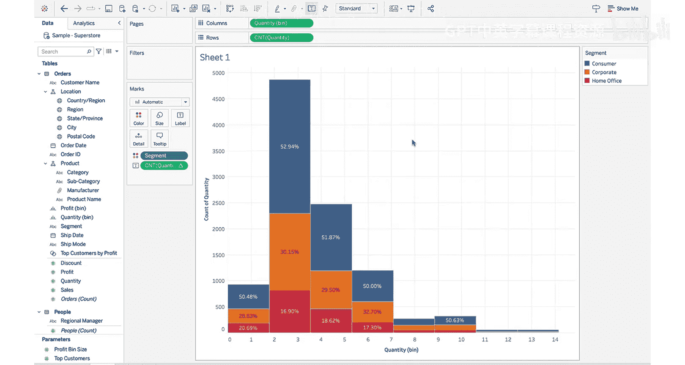

# uPenn《如何运用数据2、3（Python预测分析、数据可视化和叙事）｜How to Use Data》中英字幕 p55 10_编程演示：单维可视化之直方图.zh_en [BV1LqxEzcEBy_p55]

Now， we're going to talk about a histogram。 A histogram is like a bar chart with a twist。

 It shows you the shape of a bunch of data points。 Instead of individual bars。

 it groups those points into ranges， which we call bins。

 So if you want to see how the values are spread out and get a feel for the overall distribution。

 a histogram is the way to go。

In Tableau， you can create a histogram using Showmi。Drag quantity to columns。

Click Showhow me on the toolbar， then select the histogram chart type。

The histogram chart type is available and show me when the view contains a single measure and no dimensions。

3 things happen after you click the histogram icon and show me the view changes to show vertical bars with a continuous x axis 0 to 14 and a continuous y axis。

0 to 5000。The quantity measure you placed on the column shelf， which had been aggregated in sum。

 is replaced by a continuous quantity bin dimension。

 The green color of the field on the column shelf indicates that the field is continuous。

 The quantity measure moves to the row shelf， and the aggregation changes from sum to count。

The quantity measure captures the number of items in a particular order。

 The histogram shows that about 4800 orders contained two items。 The second bar。

 about 2400 orders contained four items。 the third bar and so on。

 Let's take this view one step further and add segment to color to see if we can detect a relationship between the customer segment。

 consumer， corporate or home office and the quantity of items per order。Drag segment to color。

The colors don't show a clear trend。 Let's show the percentage of each bar that belongs to each segment。

 Hold down the control key and drag the count quantity field from the row shelf to label。

 Holding down the control key copies the field to the new location without removing it from the original location。

Right click or control。 click on a Mac， the count quantity field on the marks card and select quick table calculation percent of total。

 Now， each colored section of each bar shows its respective percentage of the total quantity。

 But we want the percentages to be on a per bar basis。

 Right click the count quantity field on the marks card again and select edit table calculation。

In the table calculation dialog box change the value of the compute using field to sell。 Now。

 we have the view that we want。 There is still no evidence that the percentages by customer segments show any trend as the number of items in an order increases。

