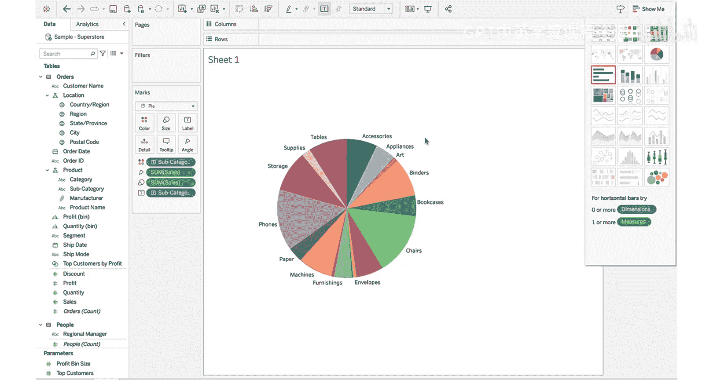

# uPenn《如何运用数据2、3（Python预测分析、数据可视化和叙事）｜How to Use Data》中英字幕 p56 11_编程演示：单维可视化之饼图.zh_en [BV1LqxEzcEBy_p56]

Now let's introduce the pie chart to create a pie chart view that shows how different product categories contribute to total sales。

 follow these steps。Drag the sales measure to columns and drag the subcatego dimension to rows。

 Tableau aggregates the sales measure as a sum。 By default， Tableau displays a bar chart。

 Click show me on the tool bar。 Then select the pie chart type。

Pie charts require at least one or more dimensions and one or two measures。

 aggregate fields such as profit ratio。 Don't contribute to those requirements。

 The resulting pi you see here is rather small to make the chart bigger。

 hold down control shift or shift Z on a Mac and press B several times。

 Add labels by dragging the subcategory dimension from the data pane to label on the markx card。

 If you don't see labels， press control shift B or shift Z B on a Mac to make sure most of the individual labels are visible。

