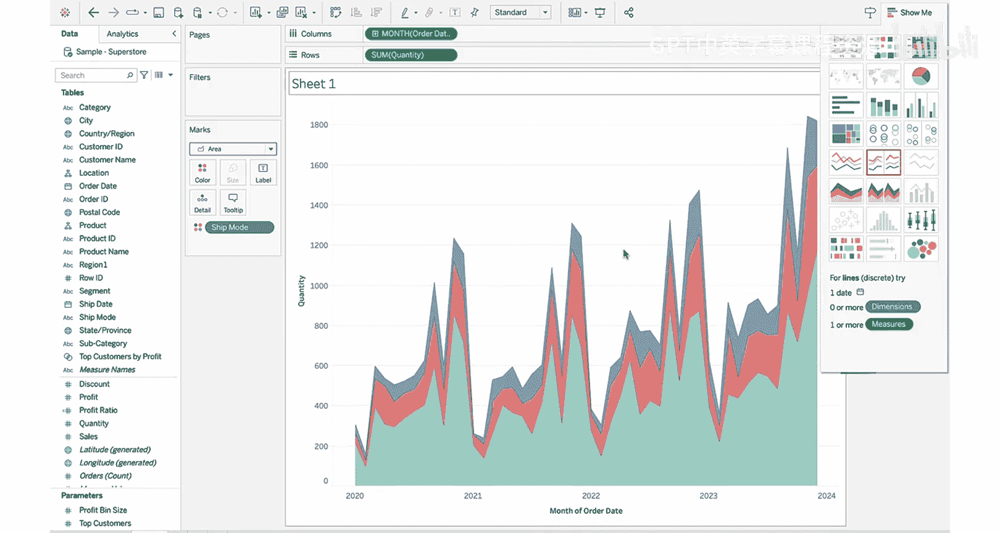

# uPenn《如何运用数据2、3（Python预测分析、数据可视化和叙事）｜How to Use Data》中英字幕 p57 12_编程演示：时间序列可视化之面积图.zh_en [BV1LqxEzcEBy_p57]

See how multiple dimensions compare over time。 Spot trends and see seasonal changes in your data。

 time series analysis with Tau is as simple as drag and drop with the ability to join separate data sources into a single graph。

 you'll gain new insights into your data。We've talked about the line chart before。

 so we'll start from area charts here。An area chart is a line chart where the area between the line and the axis is shaded with a color。

These charts are typically used to represent accumulated totals over time and are the conventional way to display stacked lines。

 Follow these steps to create an area chart from the data pane， drag order date to the column shelf。

On the column shelf， right click year order date and select month。From the data pane。

 drag quantity to the row shelf， then drag Shi mode to color on the marks card。

 then click the mark type drop down and select area。

So here's our area chart showing quantity of ship mode per month。

You can always add further formatting to an area chart。 For example， you can edit the color legend。

