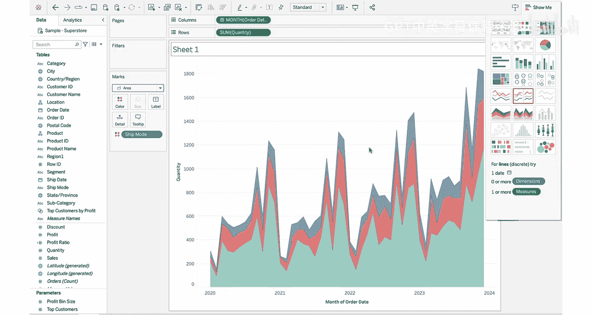

# 数据可视化：2.3：时间序列可视化之面积图 📊

在本节课中，我们将学习如何使用面积图进行时间序列分析。面积图是折线图的一种变体，它通过填充折线与坐标轴之间的区域，帮助我们更直观地观察多个维度随时间变化的累积趋势和季节性规律。

## 面积图简介

上一节我们介绍了基础的折线图，本节中我们来看看面积图。面积图是一种折线图，其中折线与坐标轴之间的区域用颜色填充。这种图表通常用于表示随时间推移的累积总量，也是展示堆叠折线图的常规方式。

## 创建面积图步骤

以下是创建面积图的具体操作步骤。

1.  从数据窗格中，将“订单日期”字段拖放到“列”功能区上。
2.  在“列”功能区上，右键点击“订单日期-年”，然后选择“月”。
3.  从数据窗格中，将“数量”字段拖放到“行”功能区上。
4.  将“运输方式”字段拖放到“标记”卡上的“颜色”属性上。
5.  点击“标记”卡上的标记类型下拉菜单，并选择“面积”。

至此，我们就得到了一个展示每月各运输方式数量的面积图。

## 图表格式化

你可以随时为面积图添加进一步的格式设置以优化其外观。例如，你可以编辑颜色图例。

---

本节课中我们一起学习了面积图的定义、创建方法及基本格式化操作。面积图能有效展示多个数据序列随时间的累积变化和对比，是观察趋势和季节性规律的强大工具。