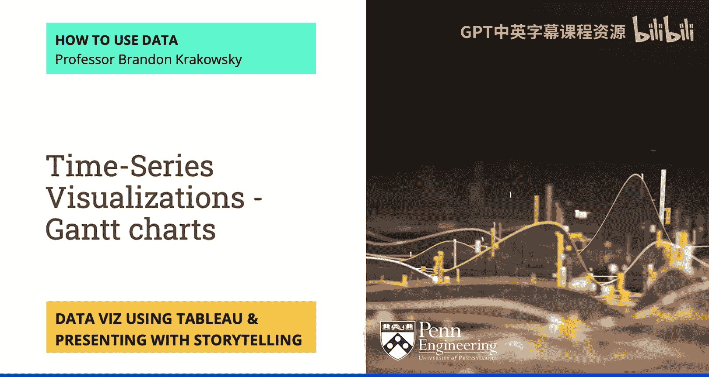
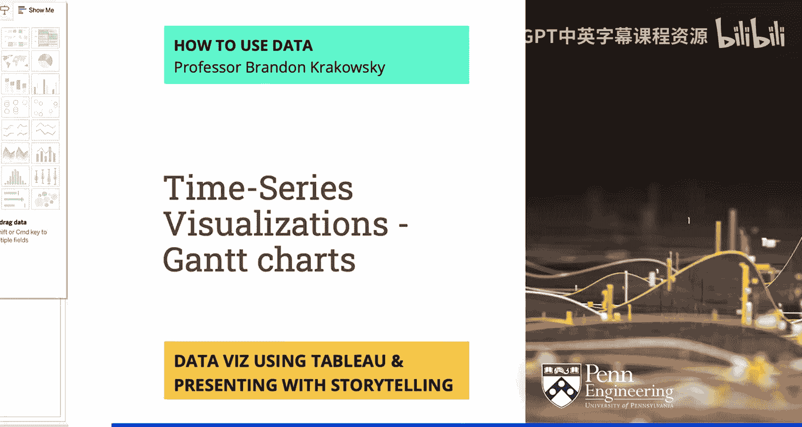
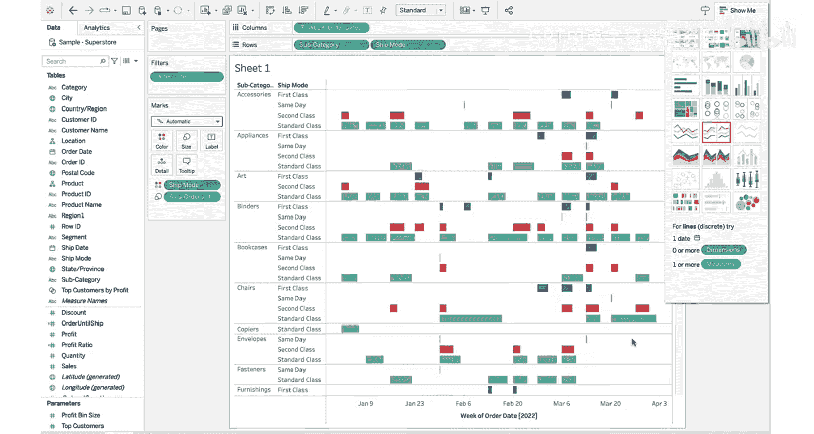

# uPenn《如何运用数据2、3（Python预测分析、数据可视化和叙事）｜How to Use Data》中英字幕 p58 13_编程演示：时间序列可视化之甘特图.zh_en [BV1LqxEzcEBy_p58]

Now， let's talk about the Gantt chart， use Gt charts to show the duration of events or activities and a Gantt chart。

 each separate mark， usually a bar shows a duration。 For example。

 you might use a Gantt chart to display average delivery time for a range of products。

To create a Gantt chart that shows how many days ellase on average between order date and ship date。

 followow these steps。 drag the order date dimension to columns。

 Tableau aggregates the dates by year and creates column headers with labels for the years。

On the column shelf， click the year order date， drop down arrow and then select week number。

 The column headers change。Individual weeks are indicated by tick marks because there are 208 weeks in a four year span。

 Too many to show as labels in the view。Drag the subcategory and ship mode dimensions to the row shelf。

Drop ship mode to the right of subcategory。 This builds a two level nested hierarchy of dimensions along the left axis。

Next， we'll size the marks according to the length of the interval between the order date and the ship date to do this。

 create a calculated field to capture that interval。In the toolbar menu。

 click Analysis Cate Calulated field。You could also right click or control click on a Mac。

 any field in the data pane and select createre Calulated field。In the calculation dialog box。

 name your calculated field order until ship。In the formula box。

 enter the following formula and then click OK dateate di， day。Second argument， order date。

 third argument， ship date。The formula creates a custom measure that captures the difference between the order date and ship date values in days。

Drag the order until ship measure to size on the marks card。

 The default aggregation for order until ship is sum。 but in this case。

 it makes more sense to average the values。Right click or control。

 click on a Mac the sum order until shape field on the marks card and then select measure average。

 The view is coming along， but there are too many marks squeezed into the view。

Hold down the control key option key on the Mac and drag the weak order date field from the column shelf to the filter shelf By holding down the control key or the option key。

 you tell Tableau that you want to copy the field to the new location with whatever customizations you've added without removing it from the old location。

In the filter field dialog box， select range of dates， and then click next。

 set the ranges to a three month time interval， such as 11，2013 to 3，31，2013， and then click O。

 It could be difficult to get the exact date using the sliders。

 It's easier just to enter the numbers you want directly into the date boxes。

 or use the calendar to select the dates。Drag the ship mode dimension to color on the marks card。

 Now， your view shows all sorts of information about the lag between order times and ship times。

 For example， you can see which ship modes are more prone to longer lag times。

 whether lag times vary by category and whether lag times are consistent over time。In conclusion。

 time series analysis is a specific way of analyzing a sequence of data points collected over a period of time。

In time series visualizations， analysts record data points at consistent intervals over a set period of time。

 rather than just recording the data points intermittently or randomly。 However。

 you should know that this type of analysis is not merely the act of collecting data over time。

 but shows how the data adjusts over the data points， as well as the final results。

 It provides an additional source of information and a set order of dependencies between the data。

 time series analysis typically requires a large number of data points to ensure consistency and reliability。

 An extensive data set ensures you have a representative sample size and that analysis can cut through noisy data。

 It also ensures that any trends or patterns discovered or not outliers and can account for seasonal variance。

Additionally， time series data can be used for forecasting。

 predicting future data based on historical data。

