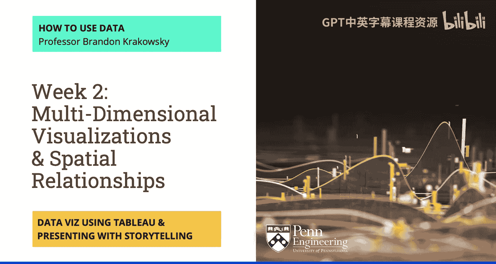
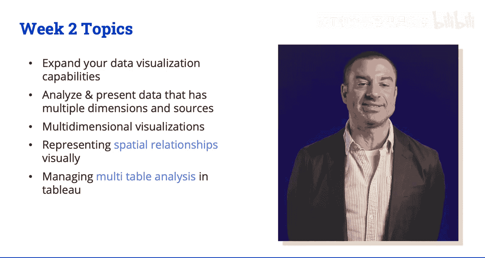

# uPenn《如何运用数据2、3（Python预测分析、数据可视化和叙事）｜How to Use Data》中英字幕 p59 14_模块二导论：多维可视化与复杂关系.zh_en [BV1LqxEzcEBy_p59]

In module 2， we advance into the realm of multidimensional visualizations and the intricacies of depicting complex spatial relationships。

 This module is designed to expand your data visualization capabilities。

 enabling you to analyze and present data that involves multiple dimensions and sources。

You'll learn how to effectively create multidimensional visualizations that can uncover deeper insights into your data while also explore spatial relationships and how they can be represented visually。

 One key focus will be on using Tau to manage multi table analysis。

 where you'll learn how to create and manage relationships and join data sets to enhance your visualizations。

By learning these advanced techniques， you'll be prepared to tackle more complex data visualization challenges。

